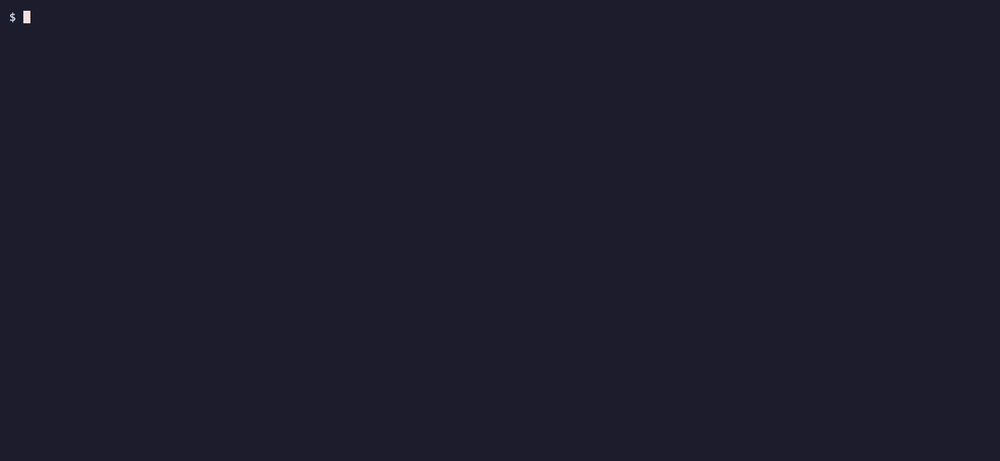

[](https://crates.io/crates/redacter)


# Redacter

Detect & Redact cli tool to find sensitive data in files, such as personal information (PII), passwords, API keys and
other secrets, and to securely copy and redact files removing it, across various sources and destinations and utilising
Data Leak/Loss Prevention (DLP) capabilities.
`redacter cp` copies files and redacts them on the way; `redacter scan` only reads them and reports what was found and
where, with an exit code a CI pipeline can gate on.

The tool ships four redacters that run entirely on your machine, a rule-based one with checksum validation, a small
multilingual named-entity model, a zero-shot span model that looks for labels you choose and a classifier for
credentials, and can also delegate to cloud DLP services and LLMs such as Google Cloud Platform's DLP API. Local
redaction keeps the data on the host and costs nothing per file. See [Choosing a redacter](#choosing-a-redacter) for the
measured recall and speed of every redacter.



## Features

* **Copy and redact:** copy files while applying DLP redaction to protect sensitive information.
* **Scan:** detect sensitive information in files without changing them, with the same redacters, and report what was
  found and where as text or JSON. See [Scan command](#scan-command).
* **Multiple sources and destinations:** the local filesystem, Google Cloud Storage (GCS), Amazon Simple Storage Service
  (S3), zip files and the clipboard (text content and images).
* **Local redacters:** four redacters that run offline on your machine. No cloud account needed:
    * `local-rules`: regex and checksum based redaction of emails, phone numbers, payment cards, IBANs, network
      addresses, secrets, national identifiers of 43 countries, postcodes and dates of birth, plus your own regex and
      dictionary rules;
    * `local-ner`: people, organisations and locations, found by a multilingual transformer model running on your CPU;
    * `local-gliner`: zero-shot span detection against free-text labels you choose, understanding context that
      `local-ner` cannot;
    * `local-credential-ml`: passwords, API keys and tokens, found by a line classifier running on your CPU, for the
      secrets that `local-rules` has no pattern for.
* **Cloud and self-hosted redacters:** see the table below. More providers can be added in the future.
* **CLI:** easy-to-use command-line interface for streamlined workflows.
* Built with Rust to ensure speed, safety, and reliability.

The files each redacter handles:

| Redacter | Text, HTML, CSV and JSON files | Images and PDF files |
|---|---|---|
| [Google Cloud Platform DLP](https://cloud.google.com/security/products/dlp?hl=en), `gcp-dlp`, accurate and customizable redaction | Text, HTML and JSON files; structured data table files (CSV) | Images (JPEG, PNG, BMP, GIF); PDF files, rendered as images |
| [Presidio](https://github.com/data-privacy-stack/presidio), `presidio`, PII redaction with no built-in secret detection; an open source project maintained by Data Privacy Stack that you can install on-prem | Text, HTML, CSV and JSON files | Images; PDF files, rendered as images |
| [GCP Vertex AI](https://cloud.google.com/vertex-ai/docs), `gcp-vertex-ai`, using any available models such as Gemini, Claude, etc. | Text, HTML, CSV and JSON files | Images, redacted by the model itself or by blacking out the coordinates it reports; PDF files, rendered as images |
| [Google Gemini API](https://ai.google.dev/), `gemini-llm` | Text, HTML, CSV and JSON files | Images, redacted by the model itself or by blacking out the coordinates it reports; PDF files, rendered as images |
| [Open AI LLM](https://openai.com/), `open-ai-llm` | Text, HTML, CSV and JSON files | Images, redacted by the model itself or by blacking out the coordinates it reports; PDF files, rendered as images |
| [AWS Comprehend](https://aws.amazon.com/comprehend/), `aws-comprehend`, PII redaction | Text, HTML, CSV and JSON files | Images through text extraction using OCR; PDF files, rendered as images and read through OCR |
| [AWS Bedrock](https://aws.amazon.com/bedrock/), `aws-bedrock`, using Amazon Nova and other models available on Bedrock | Text, HTML, CSV and JSON files | Images, redacted by blacking out the coordinates the model reports; PDF files, rendered as images |
| [AWS Bedrock Guardrails](https://aws.amazon.com/bedrock/guardrails/), `aws-bedrock-guardrails` | Text, HTML, CSV and JSON files | Not supported |
| `local-rules`, `local-ner`, `local-gliner`, `local-credential-ml` | Text, HTML, CSV and JSON files | Images through text extraction using OCR; PDF files, rendered as images and read through OCR |

## What each redacter finds

Sensitive data here means two things: personal information (PII), such as names, addresses, phone numbers and national
identifiers, and secrets, meaning credentials such as passwords, API keys, access tokens, private keys and connection
strings that carry a password. The redacters differ most on secrets.

| Redacter | Personal information | Secrets |
|---|---|---|
| `local-rules` | Emails, phone numbers, payment cards, IBANs, network addresses, national identifiers of 43 countries, postcodes and dates of birth, all by shape and checksum | Passwords and keys written as `key=value`, `key: value` or JSON fields; AWS, Google, GitHub, GitLab, Slack, Stripe, OpenAI, Anthropic, npm, SendGrid, Discord and Hugging Face credentials; values that look random after a key name such as `key`, `secret`, `token` or `auth`; JWTs; `Authorization` header values; passwords in URLs; private key blocks. A password written in prose is not found |
| `local-ner` | People, organisations and locations | None |
| `local-gliner` | The labels you choose, 14 PII labels by default | None with the default labels. Chain `local-rules` for secrets |
| `local-credential-ml` | None | Lines that a model rates as holding a credential, with the value on each line redacted: a password written in a sentence, a token with no known prefix, an OAuth client secret after a label, a `.netrc` password. It rates the AWS documentation example keys and `password: value` lines with a plain value low, and `local-rules` finds those. Chain it after `local-rules` |
| `gcp-dlp` | 13 info types, such as names, emails, phone numbers, cards, IBANs, passports and dates of birth | 15 info types: passwords, auth tokens, AWS credentials, basic auth headers, OAuth client secrets, GCP API keys, encryption keys, JWTs, HTTP cookie headers and the credential types of GCP, Azure, OpenAI and Anthropic, signed storage URLs and Tink keysets. In a test with synthetic values it found passwords, JWTs and cookie headers, and missed private key blocks and most vendor tokens |
| `aws-comprehend` | Every Comprehend PII entity type, English text only | Passwords, AWS access keys and secret keys, PINs and usernames. It may redact only part of another token and leave the rest in place |
| `aws-bedrock-guardrails` | The PII types the guardrail enables | Passwords, AWS keys, PINs and usernames when the guardrail enables them, plus any shape you add as a regex filter. It may redact only part of another token |
| `presidio` | Presidio's default recognizers | None built in. Custom recognizers are added on the Presidio side |
| `gcp-vertex-ai`, `gemini-llm`, `open-ai-llm`, `aws-bedrock` | Whatever the model recognises as personal information | Passwords, API keys, access tokens and private keys in text, as the prompt asks. In an image test, Gemini located the secrets of a `.env` screenshot, and Amazon Nova's boxes missed them, which is a limit of the model |

Models answer differently from run to run, so check the output of an LLM redacter before relying on it. To cover both
kinds of data, chain redacters: for a text file, `-d local-rules -d gcp-dlp` redacts the secrets and the pattern-shaped
PII locally before the rest is sent to GCP DLP. GCP DLP reads an image, or a PDF rendered to page images, natively, so
those go to it whole, see [Multiple redacters](#multiple-redacters).

## Choosing a redacter

The local redacters run on your machine, so nothing leaves it, nothing is billed and nothing needs credentials.
`presidio` runs where you deploy it. The cloud services and LLMs are billed for what they read, and they receive the
content of the files, see [what is sent where](docs/dlp-comparison.md#local-or-cloud). The table gives the recall of each
redacter on four datasets (recall is the share of the sensitive values that it found) and the time per file on `public`.
A `+` joins redacters given to one scan, such as `-d local-rules -d local-gliner`.

| Redacter | PII documents | Secrets in config and code | Public PII sample | Scanned form | Per file on public PII sample |
|---|---|---|---|---|---|
| `local-rules` | 54% | 93% | 24% | 62% | under 1 ms |
| `local-ner` | 23% | 0% | 23% | 19% | 37 ms |
| `local-gliner` | 100% | 2% | 55% | 88% | 423 ms |
| `local-rules+local-ner` | 77% | 93% | 46% | 94% | 38 ms |
| `local-rules+local-gliner` | 100% | 93% | 57% | 88% | 421 ms |
| `local-credential-ml` | 0% | 61% | 2% | 0% | 28 ms |
| `local-rules+local-credential-ml` | 54% | 95% | 25% | 62% | 28 ms |
| `presidio` | 69% | 7% | 66% | 69% | 11 ms |
| `gcp-dlp` | 85% | 41% | 49% | 94% | 77 ms |
| `aws-comprehend` | 98% | 56% | 80% | 94% | 86 ms |
| `aws-bedrock-guardrails` | 90% | 46% | 74% | 81% | 175 ms |
| `gcp-vertex-ai` | 100% | 100% | 84% | 100% | 11.3 s |
| `aws-bedrock` | 98% | 88% | 85% | 88% | 704 ms |

PII documents is `fixtures`: 8 text files with personal data in several formats and languages. Secrets in config and code is `secrets`: 29 files with 41 planted passwords, keys and tokens. Public PII sample is `public`: 200 records of [nvidia/Nemotron-PII](https://huggingface.co/datasets/nvidia/Nemotron-PII) (CC BY 4.0), synthetic personal data. Scanned form is `images`: a PNG and a PDF of one customer form. The image rows measure the coordinates a redacter reports to `scan`, not the native image edit of the LLM redacters.

Measured on commit `3a089bb` on an Apple M6 Mac mini. The time per file includes the start of the process and the load of the
models. `gemini-llm` and `open-ai-llm` were not measured.

- To keep the data on the machine, start with `local-rules+local-gliner`, which is `-d local-rules -d local-gliner`.
- For secrets, `local-rules` found 93% at 1 ms per file, `local-rules+local-credential-ml` 95%, and `gcp-vertex-ai` found all of them.
- For personal information in free text, `local-gliner` found every value in `fixtures`, and on `public` `aws-bedrock` (85%), `gcp-vertex-ai` (84%) and `aws-comprehend` (80%) found the most.
- To find more, chain a cloud redacter after the local pass, see [Multiple redacters](#multiple-redacters). Which redacter finds the most depends on the data, so use several for the most protection.
- The local redacters give the same output for the same input, which makes results easy to test and audit. The model of `local-gliner` is a ~1.17 GB download and needs about 1.5 GB of memory while running, against 132 MB and 232 MB for `local-ner`. The `local-credential-ml` model is a 126 MiB download and the process holds about 190 MiB.

Precision, recall per category, speed on every dataset, the speed and memory of the local models, what each redacter sends out, the limits of the measurement and the commands to reproduce it are in [docs/dlp-comparison.md](docs/dlp-comparison.md).

## Installation

### Install script

On macOS, Linux and FreeBSD:

```sh
curl -fsSL https://raw.githubusercontent.com/abdolence/redacter-rs/master/install.sh | sh
```

On Windows (PowerShell):

```powershell
irm https://raw.githubusercontent.com/abdolence/redacter-rs/master/install.ps1 | iex
```

The scripts pick the archive for your operating system and architecture from the latest release
and verify it against the SHA-256 digest GitHub records for it; nothing is installed if the digest
is missing or does not match, or if the downloaded binary does not run on your system. Running a
script again upgrades redacter in place. The Linux x86_64 and aarch64 archives are built for glibc;
on musl systems such as Alpine use [Cargo](#cargo).

* `REDACTER_INSTALL_DIR`: the install directory. Default is `~/.local/bin` on macOS, Linux and FreeBSD
  and `%LOCALAPPDATA%\Programs\redacter` on Windows;
* `REDACTER_VERSION`: the release tag to install, such as `v0.21.0`. Default is the latest release.

The Windows script adds the install directory to your user `PATH`; the shell script prints the
`export` line to add if the directory is not on your `PATH`.

To install a specific version on macOS, Linux and FreeBSD:

```sh
curl -fsSL https://raw.githubusercontent.com/abdolence/redacter-rs/master/install.sh | env REDACTER_VERSION=v0.21.0 sh
```

On Windows:

```powershell
& { try { $env:REDACTER_VERSION = 'v0.21.0'; irm https://raw.githubusercontent.com/abdolence/redacter-rs/master/install.ps1 | iex } finally { Remove-Item Env:REDACTER_VERSION } }
```

To install into a custom directory on macOS, Linux and FreeBSD:

```sh
curl -fsSL https://raw.githubusercontent.com/abdolence/redacter-rs/master/install.sh | env REDACTER_INSTALL_DIR=$HOME/bin sh
```

On Windows:

```powershell
& { try { $env:REDACTER_INSTALL_DIR = 'C:\Tools\redacter'; irm https://raw.githubusercontent.com/abdolence/redacter-rs/master/install.ps1 | iex } finally { Remove-Item Env:REDACTER_INSTALL_DIR } }
```

### Binary releases

Download the latest release from [the GitHub releases](https://github.com/abdolence/redacter-rs/releases).

The Linux x86_64 and aarch64 archives need glibc 2.18 or newer; the Linux arm archive is static (musl) and needs no glibc.

### Cargo

```sh
cargo install redacter
```

### Optional capabilities installation

PDF redaction, OCR (for the DLP providers that can't read images) and the `local-ner`, `local-gliner` and
`local-credential-ml` redacters need addons that are not bundled with the tool. Install the ones you need with
`redacter addons install`, see [Addons](#addons).

## Command line options

Copy and redact files from a source to a destination.

DLP is optional and should be enabled with `--redact` (`-d`) option.
Without DLP enabled, the tool will copy all files without redaction.
With DLP enabled, the tool will redact files based on the DLP model and skip unsupported files.

`--report-file` saves the result of the command to a file as JSON by default, as the three counts with
`--report-format text`, as a [SARIF report](docs/reports.md#sarif-report) with `--report-format sarif`, or as an
[OCSF report](docs/reports.md#ocsf-report) with `--report-format ocsf`. The terminal output is the same with or without it. `--report-file` and `--report-format` replace `--save-json-results`, which
is no longer accepted. `scan` takes the same two options, see [Scan command](#scan-command).

`--categories` limits a run to some kinds of data, such as secrets only. `scan` takes it too, see
[Limiting to data categories](#limiting-to-data-categories).

<details>
<summary>Full output of <code>redacter cp --help</code></summary>

```
Usage: redacter cp [OPTIONS] <SOURCE> <DESTINATION>

Arguments:
  <SOURCE>
          Source directory or file such as /tmp, /tmp/file.txt or gs://bucket/file.txt and others supported providers

  <DESTINATION>
          Destination directory or file such as /tmp, /tmp/file.txt or gs://bucket/file.txt and others supported providers

Options:
      --addons-dir <ADDONS_DIR>
          Directory holding the addons that `addons install` installs and manually placed copies, one subdirectory per addon. Overrides the REDACTER_ADDONS_DIR environment variable. Default is the user cache directory, for example ~/.cache/redacter/addons

  -m, --max-size-limit <MAX_SIZE_LIMIT>
          Maximum size of files to copy in bytes

  -n, --max-files-limit <MAX_FILES_LIMIT>
          Maximum number of files to copy. Sort order is not guaranteed and depends on the provider

  -f, --filename-filter <FILENAME_FILTER>
          Filter by name using glob patterns such as *.txt

  -d, --redact <REDACT>
          List of redacters to use
          
          [possible values: gcp-dlp, aws-comprehend, presidio, gemini-llm, open-ai-llm, gcp-vertex-ai, aws-bedrock, aws-bedrock-guardrails, local-rules, local-ner, local-gliner, local-credential-ml]

      --allow-unsupported-copies
          Allow unsupported types to be copied without redaction

      --unsupported-as-text
          Read files of a type no redacter supports, such as .env files, keys and source code, as text when they are valid UTF-8 without NUL bytes

      --gcp-project-id <GCP_PROJECT_ID>
          GCP project id that will be used to redact and bill API calls

      --gcp-dlp-built-in-info-type <GCP_DLP_BUILT_IN_INFO_TYPE>
          Additional GCP DLP built in info types for redaction

      --gcp-dlp-stored-info-type <GCP_DLP_STORED_INFO_TYPE>
          Additional GCP DLP user defined stored info types for redaction

      --categories <CATEGORIES>
          Data categories to look for, comma separated, or only exclusions with a leading ! to look for every category but those, such as --categories '!other' (use single quotes: an interactive bash or zsh expands a ! as history, in double quotes too). scan reports only findings in these categories. cp redacts only data in these categories and copies everything else as it is. Presidio and the LLM redacters then read images and PDF pages with OCR. Default is every category
          
          [possible values: person, contact, address, location, organization, id-number, financial, date-of-birth, secrets, network, other]

      --llm-image-mode <LLM_IMAGE_MODE>
          How LLM redacters redact images: 'native' lets the model edit the image, 'coords' asks the model for coordinates and blacks them out locally, 'auto' edits natively then verifies the edit with the coordinate pass, falling back to coordinates entirely when the model cannot edit images. Default is 'auto'

          Possible values:
          - auto:   Edit the image with the model, verify the edit with the coordinate pass, and fall back to coordinates entirely when the model cannot edit images
          - native: Always edit the image with the model, failing when it cannot
          - coords: Always ask the model where the sensitive data is and black it out locally

      --gcp-region <GCP_REGION>
          GCP location for Vertex AI. Default is 'global'; 'us' and 'eu' multi-regions and regional locations such as 'us-central1' are accepted

      --gcp-vertex-ai-text-model <GCP_VERTEX_AI_TEXT_MODEL>
          Model name for text redaction in Vertex AI, also used to locate sensitive data in images. Default is 'publishers/google/models/gemini-3.8-flash'

      --gcp-vertex-ai-image-model <GCP_VERTEX_AI_IMAGE_MODEL>
          Model name for native image editing in Vertex AI. Default is 'publishers/google/models/gemini-3.1-flash-image'

      --gcp-vertex-ai-block-none-harmful
          Block none harmful content threshold for Vertex AI redacter. Default is BlockOnlyHigh since BlockNone is required a special billing settings.

      --csv-headers-disable
          Disable CSV headers (if they are not present)

      --csv-delimiter <CSV_DELIMITER>
          CSV delimiter (default is ',')

      --aws-region <AWS_REGION>
          AWS region for the AWS Comprehend and AWS Bedrock redacters

      --aws-bedrock-text-model <AWS_BEDROCK_TEXT_MODEL>
          Bedrock model id for text redaction, also used to locate sensitive data in images and, since Bedrock has no active image editing model, to redact images. Default is 'amazon.nova-2-lite-v1:0' with the inference profile prefix of the selected region ('us.', 'eu.' or 'jp.'), falling back to the 'global.' profile elsewhere

      --aws-bedrock-guardrail-id <AWS_BEDROCK_GUARDRAIL_ID>
          Guardrail id for the AWS Bedrock Guardrails redacter

      --aws-bedrock-guardrail-version <AWS_BEDROCK_GUARDRAIL_VERSION>
          Guardrail version for the AWS Bedrock Guardrails redacter. Default is 'DRAFT'

      --presidio-text-analyze-url <PRESIDIO_TEXT_ANALYZE_URL>
          URL for text analyze endpoint for Presidio redacter

      --presidio-image-redact-url <PRESIDIO_IMAGE_REDACT_URL>
          URL for image redact endpoint for Presidio redacter

      --gemini-model <GEMINI_MODEL>
          Gemini model name for text redaction, also used to locate sensitive data in images. Default is 'models/gemini-3.8-flash'

      --gemini-image-model <GEMINI_IMAGE_MODEL>
          Gemini model name for native image editing. Default is 'models/gemini-3.1-flash-image'

      --sampling-size <SAMPLING_SIZE>
          Sampling size in bytes before redacting files. Disabled by default

      --open-ai-api-key <OPEN_AI_API_KEY>
          API key for OpenAI LLM redacter

      --open-ai-model <OPEN_AI_MODEL>
          Open AI chat model name for text redaction, also used to locate sensitive data in images. Default is 'gpt-5.6-luna'

      --open-ai-image-model <OPEN_AI_IMAGE_MODEL>
          Open AI model name for native image editing. Default is 'gpt-image-2'

      --limit-dlp-requests <LIMIT_DLP_REQUESTS>
          Limit the number of requests to cloud providers, as '10rps' or '100rpm'. Some providers have strict quotas and to avoid errors, the requests are delayed. Every call counts, a retry included, a PDF counts each page and a long text counts each piece. One limit is shared by all the providers of a run, and local redacters are not limited. Default is disabled

      --local-rules <LOCAL_RULES>
          Rule groups enabled for the local-rules redacter, comma separated. Default is every group
          
          [possible values: email, phone, payment-card, iban, network, url, secrets, us-identifiers, eu-identifiers, world-identifiers, postcodes, birth-dates, custom]

      --local-rules-disable <LOCAL_RULES_DISABLE>
          Rule groups disabled for the local-rules redacter, comma separated. Applied after --local-rules
          
          [possible values: email, phone, payment-card, iban, network, url, secrets, us-identifiers, eu-identifiers, world-identifiers, postcodes, birth-dates, custom]

      --local-rule <LOCAL_RULE>
          User-defined regex rule for the local-rules redacter in the form name=regex. Can be repeated

      --local-rules-file <LOCAL_RULES_FILE>
          JSON file with user-defined regex and dictionary rules for the local-rules redacter. Can be repeated

      --local-ner-entities <LOCAL_NER_ENTITIES>
          Entity types the local-ner redacter removes, comma separated: per (people), org (organisations), loc (locations). Default is all three
          
          [possible values: per, org, loc]

      --local-ner-min-score <LOCAL_NER_MIN_SCORE>
          Minimum model confidence for a word to be redacted by local-ner, between 0 and 1. Lower values redact more. Default is 0.5
          
          [default: 0.5]

      --local-gliner-labels <LOCAL_GLINER_LABELS>
          Entity labels the local-gliner redacter looks for, comma separated, free text understood by the model (for example "person,email,medical condition"). Default is a PII list: person, address, email, phone number, date of birth, passport number, national id number, credit card number, iban, ip address, username, medical condition, postal code, license plate number

      --local-gliner-min-score <LOCAL_GLINER_MIN_SCORE>
          Minimum model confidence for a span to be redacted by local-gliner, between 0 and 1. Lower values redact more. Default is 0.5
          
          [default: 0.5]

      --local-credential-ml-min-score <LOCAL_CREDENTIAL_ML_MIN_SCORE>
          Minimum model confidence for a line to be redacted by local-credential-ml, between 0 and 1. Lower values redact more. Default is 0.74, the model card's threshold
          
          [default: 0.74]

      --mime-override <MIME_OVERRIDE>
          Override media type detection using glob patterns such as 'text/plain=*.md'

      --report-file <REPORT_FILE>
          Write the report to this file

      --report-format <REPORT_FORMAT>
          Format of the report file: 'json' for machines, 'text' for people, 'sarif' for GitHub code scanning, 'ocsf' for SIEMs and security data lakes (SARIF and OCSF reports always hold masked values). Requires --report-file. Default is 'json'

          Possible values:
          - json
          - text
          - sarif: SARIF 2.1.0, for GitHub code scanning
          - ocsf:  OCSF 1.9.0 Data Security Finding events, one JSON object per line, for SIEMs and security data lakes
          
          [default: json]

  -h, --help
          Print help (see a summary with '-h')
```

</details>

### Limiting to data categories

`--categories` takes a comma separated list of the categories to look for and needs `--redact`. Without it every
category is in scope. `scan` reports only the findings in the chosen categories. `cp` redacts only the data in the
chosen categories and copies everything else as it is.

Be aware that `cp` with `--categories` leaves the data outside the chosen categories in the copy. Use it to remove one
kind of data from files, and leave the option out, or name every kind that must go, for a copy that is safe to share.

Every finding of every redacter is in exactly one of eleven categories:

| Category | Holds |
|---|---|
| `person` | Names of people and user names |
| `contact` | Email addresses, phone and fax numbers |
| `address` | Street addresses, postcodes and geographic coordinates |
| `location` | Cities, regions, countries and other named places that are not street addresses |
| `organization` | Companies, institutions and employers |
| `id-number` | National, tax, passport, driving licence, health, customer, employee, vehicle and device identifiers |
| `financial` | Payment card numbers and their security codes, bank account and routing numbers, IBAN and SWIFT codes |
| `date-of-birth` | Dates of birth |
| `secrets` | Passwords, PINs, API keys, access tokens, private keys, session cookies and other secrets |
| `network` | IP addresses, MAC addresses and URLs |
| `other` | Any other personal or sensitive information, see [What `other` holds](#what-other-holds) |

A list of names looks for exactly those categories. A list of exclusions, each with a leading `!`, looks for every
category except those, including the categories that later releases add. A list is either names or exclusions; mixing
them, a name that is not a category and exclusions that leave no category are usage errors. Naming a category twice is
harmless. The reports state the resolved list of categories, not the expression. Naming all eleven categories limits
nothing, and the output is the same as without the option.

```sh
redacter scan . -d local-rules --categories '!other'
```

Quote an exclusion in single quotes: an interactive bash or zsh expands a `!` as history, in double quotes too.

#### What `other` holds

A rule or a label that the list of its redacter does not place is `other`. The table lists what the lists of the
redacters put there:

| Kind of data | Where it comes from |
|---|---|
| Dates that are not a date of birth | `DATE_TIME` of `aws-comprehend` and `presidio` |
| Age | `AGE` of `gcp-dlp`, `aws-comprehend` and `aws-bedrock-guardrails` |
| Gender | `GENDER` of `gcp-dlp` |
| Nationality, religious or political group | `NRP` of `presidio` |
| Medical details | `medical condition` of `local-gliner`, and the `MEDICAL_*` entities of `presidio` but `MEDICAL_LICENSE` |
| UUIDs | `UUID` of `presidio` |
| Every user rule without a `category` | `--local-rule`, and a rule of `--local-rules-file` that names none |
| Info types the user adds | `--gcp-dlp-stored-info-type`, and a `--gcp-dlp-built-in-info-type` that is not a default |
| Anything a model could not classify | `sensitive_data` of the LLM redacters, a label added with `--local-gliner-labels` that names no organisation or place, `ALL` and the types later added of `aws-comprehend`, the regex filters of `aws-bedrock-guardrails` and an entity that a custom recogniser of `presidio` adds |

`--categories secrets` therefore leaves out a rule of a rules file that has no `category`, since it is `other`, and
refuses an inline `--local-rule`, which is always `other`, see
[Categories and redacter options](#categories-and-redacter-options). Add `other` to keep them, as in
`--categories secrets,other`. A rule of a rules file with a `category` is kept when that category is chosen.

How a redacter honours the categories depends on what its service lets the tool ask for. A redacter is *narrowed* when
its request or configuration holds only the chosen categories, so the other kinds are not looked for at all, and
*filtered* when it looks for everything and the tool drops the findings outside the chosen categories. For a
filtered redacter `cp` detects the values and masks them itself, with one provider call for each item, as without
the option.

| Redacter | `scan` | `cp` on text | Images and PDF pages |
|---|---|---|---|
| `local-rules` | Narrowed: only the rule groups of the chosen categories run | The same groups; a value becomes `[REDACTED]` | OCR, then as for text |
| `local-ner` | Narrowed: `per` is `person`, `org` is `organization` and `loc` is `location` | The same entities; `[REDACTED]` | OCR, then as for text |
| `local-gliner` | Narrowed: only the default labels of the chosen categories are asked for | The same labels; `[REDACTED]` | OCR, then as for text |
| `local-credential-ml` | Runs only when `secrets` is chosen | The same; `[REDACTED]` | OCR, then as for text |
| `gcp-dlp` | Narrowed: only the info types of the chosen categories are in the request | The same info types; `[REDACTED]` | Read by DLP with the same info types |
| `aws-comprehend` | Filtered | Detected, filtered and masked by the tool; one `X` for each character of the value | OCR, then as for text |
| `presidio` | Filtered | The same as `aws-comprehend` | OCR, then as for text; the image endpoint is not used |
| `aws-bedrock-guardrails` | Filtered | The same, with the type of the guardrail or the name of its regex in braces, such as `{EMAIL}`, in place of the value | OCR, then as for text |
| `gemini-llm`, `open-ai-llm`, `gcp-vertex-ai`, `aws-bedrock` | Narrowed and filtered: the prompt asks only for the types of the chosen categories, and for each chosen category by its own name, such as `network` or `location`, for the kinds that have no type of their own | Detected with that prompt, filtered and masked as for `aws-comprehend`; the model does not rewrite the text | OCR, then as for text; the model does not read the image |

The category of a model's finding is the model's judgement, as the finding is, and a value can land in the wrong one.
GLiNER given fewer labels can also settle on slightly different spans for the labels that remain.

Presidio and the LLM redacters read an image with OCR under `--categories`, where without it they read the image
themselves: the Presidio image endpoint takes no list of entities, and a model returns boxes with no category. The
text OCR reads goes through the text path above, and the words found are blacked out. This has consequences:

- the `ocr` addon is needed, see [Addons](#addons), and PDF pages need the `pdf` addon too. Without them the file is not
  redacted: `scan` reports it as blocked and exits with 1, and `cp` skips it, or copies it as it is with
  `--allow-unsupported-copies`;
- text that OCR cannot read, such as handwriting or stylised lettering, is not found, where a model reading the image
  could have found it;
- as without `--categories`, a redacter that reads the image itself (GCP DLP) takes it, and OCR is used only when none
  does, see [Multiple redacters](#multiple-redacters).

#### Categories and redacter options

The categories meet the options of a redacter as an intersection: a detector runs when its option selects it and its
category is chosen.

- A default list is narrowed without a message: the rule groups when `--local-rules` is absent, the default entities
  when `--local-ner-entities` is absent, the default `--local-gliner-labels` and the 28 default info types of GCP DLP.
- A value named on the command line is checked, and one outside the chosen categories is refused before any file is
  read. This covers `--local-rules`, `--local-ner-entities`, `--local-gliner-labels`, `--gcp-dlp-built-in-info-type`,
  `--gcp-dlp-stored-info-type` and `--local-rule`. `--local-rules-disable` only removes groups, so it is applied
  after. A rule of a `--local-rules-file` in a category that is not chosen is left out of the run without a message,
  as a rule group is, since one file can hold rules of several categories.
- A redacter left with nothing to find is refused too.
- The options that steer how Presidio and the LLM redacters redact images are refused, since those redacters read
  images with OCR instead: `--llm-image-mode`, `--presidio-image-redact-url`, `--gemini-image-model`,
  `--open-ai-image-model` and `--gcp-vertex-ai-image-model`.

```
$ redacter scan . -d local-rules --local-rules email,secrets --categories secrets
Error: --local-rules email is in the contact category, which --categories leaves out

$ redacter scan . -d local-ner --categories secrets
Error: local-ner finds nothing in the chosen categories: secrets
```

A redacter finds nothing when no rule group, entity, label or info type of it is in the chosen categories. This is
checked for the local redacters, `gcp-dlp` and `aws-comprehend`. Each has nothing for these categories:

- `local-rules`: `person`, `location`, `organization`, and `other` unless a rule of your own is given;
- `local-ner`: every category but `person`, `organization` and `location`;
- `local-gliner`: `location`, `organization` and `secrets`, unless a label for it is added with
  `--local-gliner-labels`, see [GLiNER](#local-gliner-redacter);
- `local-credential-ml`: every category but `secrets`;
- `gcp-dlp`: `location` and `organization`. Its `LOCATION` info type, "a physical address or location", is placed in
  `address`, so a city it finds is masked under `address`, and `'!location'` does not keep it;
- `aws-comprehend`: `location`, `organization` and `date-of-birth`.

Presidio and Guardrails are configured on their server or in AWS, so they run and may find nothing: Presidio has no
recogniser for `secrets`. The LLM redacters can find any category.

`cp` fails a file when an LLM redacter or Guardrails names a value in the chosen categories that the tool cannot place
in the text, and when an LLM redacter answers with a type that is none of the kinds the tool knows, or with
`sensitive_data` while `other` is not chosen. The file is reported as an error and is not copied, since copying it
would leave the value in place. A type that is a known kind of
a category that is not chosen, such as `person_name` when persons are not chosen, is out of scope, and the value is
dropped. A value outside the chosen categories that cannot be placed is ignored, and does not make a file unconfirmed
in `scan`.

#### Categories in the reports

With `--categories` the reports state the categories, and without it they have no such field or line. The
[JSON report](docs/reports.md#json-report) of `scan` and the [copy report](docs/reports.md#copy-report) have `categories`, the
[SARIF report](docs/reports.md#sarif-report) has it in the properties of the run, and the [text report](docs/reports.md#text-report) states it in the
closing summary line of `scan` and in a first line of `cp`. The terminal shows the categories at the end of the line
that lists the redacters and converters and at the end of the closing summary line. A finding in the `secrets` category is High severity in the
[OCSF report](docs/reports.md#ocsf-report).

#### Examples of limiting to categories

A CI job that fails on a secret in the repository. With `--categories secrets`, `local-rules` runs the `secrets` and
`url` groups only:

```sh
redacter scan . -d local-rules --categories secrets --unsupported-as-text --report-file scan-report.json
```

A copy that removes emails and phone numbers and leaves the rest of the files as they are:

```sh
redacter cp -d local-rules --categories contact customers/ redacted/
```

A scan for every category but `other`, which leaves out the custom rules and the kinds of data that fit no other
category:

```sh
redacter scan . -d local-rules --categories '!other'
```

### Copy exit codes

`cp` exits with 1 when at least one file ends in an error. The file is shown as an error in the summary line, is reported
with the status `failed`, and is not copied. The other files are still copied. An invalid command line exits with 1 as
well.

Skipped files do not change the exit code: a file that no redacter supports and that `--allow-unsupported-copies` does
not copy, a file left out by `--max-size-limit` or `--filename-filter`, and a file that needs the `ocr` or `pdf` addon
when it is not installed. A copy that ends with 0 may therefore have left files at the source.

### Copy report

`--report-file` writes a report of the files a copy met: the counters `files_copied`, `files_redacted` and `files_skipped`, and for each file its `status`, its `reason` and the `redactions` that were made, each with its `location`. The fields, the statuses and how a redaction is located are in [docs/reports.md](docs/reports.md#copy-report).

A text file of more than about 4 MiB is redacted in pieces when every selected redacter is `local-rules` or
`local-credential-ml`, a CSV file with a lot of cells in batches of rows, and a text that does not fit in one request of
`aws-comprehend`, `presidio`, `gcp-dlp` or `aws-bedrock-guardrails` in pieces that fill a request. The LLM redacters,
`local-ner`, `local-gliner` and `--sampling-size` read the file whole. A file that is not valid UTF-8 fails with the byte
it fails at. The limits, the memory and time measured and the temporary file that keeps the redactions of a report are in
[docs/large-files.md](docs/large-files.md#copy).

## Source and destinations

Source/destination can be a local file or directory, or a file in GCS, S3, and others:

- Local file: `/tmp/file.txt` or `/tmp` for whole directory recursive copy
- GCS: `gs://bucket/file.txt` or `gs://bucket/test-dir/` for whole directory recursive copy
- S3: `s3://bucket/file.txt` or `s3://bucket/test-dir/` for whole directory recursive copy
- Zip archive: `zip://tmp/archive.zip`
- Clipboard: `clipboard://`

A local directory source leaves out every `.git` directory below it, nested clones included, in `scan`, `cp` and `ls`,
whatever the ignore settings. A repository's reflog holds the committer's email address, and its object store is large.
A source inside a `.git` directory, such as `.git/logs`, is read as given. A `.git` file, which a submodule has instead
of a directory, is an ordinary file.

A copy that fails leaves no partial file at a local destination. A local file is written to a temporary file beside
the destination and renamed into place once complete, so a file it would have replaced stays intact. In a zip archive,
a file that fails is left out of the entries and the other entries stay. The compressed bytes it had written before the
failure stay in the archive as unused space, up to the compressed size of what was written. They are the redacted
output, or the content of the file where it is copied unredacted. The archive is deleted when no file was written to
it, when writing it fails or when the copy stops with an error.

S3 uploads over 8 MiB use multipart upload, so memory holds about one part rather than the whole file. An upload that is
killed, or whose `AbortMultipartUpload` request fails, leaves its stored parts billed until they are aborted. Add an
`AbortIncompleteMultipartUpload` lifecycle rule to the bucket to remove them. A bucket encrypted with SSE-KMS needs the
`kms:Decrypt` permission, besides `kms:GenerateDataKey`, for uploads over one part.

GCS uploads and downloads are verified with CRC32C. Cloud Storage rejects an upload whose data does not match the
checksum sent with it, so no object is created. A download is checked against the checksum of the whole object, and a
mismatch fails the copy with a checksum error.

## DLP and redacters

### Google Cloud Platform DLP

To be able to use GCP DLP you need to:

- authenticate using `gcloud auth application-default login` or provide a service account key
  using `GOOGLE_APPLICATION_CREDENTIALS` environment variable.
- provide a GCP project id using `--gcp-project-id` option.

Additionally you can provide the list of user defined info types using `--gcp-dlp-stored-info-type` option.

The built-in info types sent by default cover personal information and credentials. `--gcp-dlp-built-in-info-type`
adds more, see the [infoTypes reference](https://docs.cloud.google.com/sensitive-data-protection/docs/infotypes-reference).

### Presidio

Presidio's default recognizers find personal information only. To find secrets, add custom recognizers on the Presidio
side.

To be able to use Presidio you need to have a running instance of the Presidio API.
The project is maintained by [Data Privacy Stack](https://github.com/data-privacy-stack) and publishes the
analyzer and the image redactor as container images. You can run them locally or deploy them to your infrastructure:

```sh
docker run -d -p 5002:3000 ghcr.io/data-privacy-stack/presidio-analyzer:latest
docker run -d -p 5003:3000 ghcr.io/data-privacy-stack/presidio-image-redactor:latest
```

You need to provide the URLs for text analysis and image redaction endpoints using `--presidio-text-analyze-url` and
`--presidio-image-redact-url` options.

The `ms-presidio` redacter name and the `--ms-presidio-*` options still work, but are deprecated and print a warning.

### GCP Vertex AI

Vertex AI redacter supports any available models on GCP Vertex AI Models Garden, such as:

- Google Gemini
- Claude
- etc.

Default models are set to Gemini models.

To be able to use GCP Vertex AI you need to:

- authenticate using `gcloud auth application-default login` or provide a service account key
  using `GOOGLE_APPLICATION_CREDENTIALS` environment variable.
- provide a GCP project id using `--gcp-project-id` option.

The location is optional and defaults to `global`. Use `--gcp-region` to pick another one: the `us` and `eu`
multi-regions and regional locations such as `us-central1` are accepted. Note that the Gemini 3.x models are
served only on `global`, `us` and `eu`.

You can specify different models using `--gcp-vertex-ai-text-model` and `--gcp-vertex-ai-image-model` options.
By default, they are set to:

- `publishers/google/models/gemini-3.8-flash` for the text model
- `publishers/google/models/gemini-3.1-flash-image` for the image model

### Google Gemini API

To be able to use the Gemini API redacter you need to authenticate with credentials that carry the
`https://www.googleapis.com/auth/generative-language` scope and provide a GCP project id using `--gcp-project-id`.
Models are selected with `--gemini-model` (default `models/gemini-3.8-flash`) and `--gemini-image-model`
(default `models/gemini-3.1-flash-image`).

### Open AI LLM

To be able to use Open AI LLM you need to provide an API key using `--open-ai-api-key` command line option.
Optionally, you can provide model names using `--open-ai-model` (default `gpt-5.6-luna`) and
`--open-ai-image-model` (default `gpt-image-2`) options.

### Image redaction with LLM redacters

GCP Vertex AI, Gemini API and Open AI redact images in one of two ways, selected with
`--llm-image-mode`; AWS Bedrock has no active image editing model and always redacts images by
coordinates, so `--llm-image-mode native` is rejected for it:

- `native` (the image model edits the image and returns it with the sensitive data covered by black boxes);
- `coords` (the text model reports the coordinates of the sensitive data and the tool blacks them out locally);
- `auto` (the default): the native path is tried first and its result is then verified by running the coordinate
  path over the edited image, blacking out anything the model left legible; the tool falls back to coordinates
  entirely when the model cannot edit images. Authentication, permission and quota errors are never retried.

### AWS Comprehend

To be able to use AWS Comprehend DLP you need to authenticate using `aws configure` or provide a service account.
To provide an AWS region use `--aws-region` option since AWS Comprehend may not be available in all regions.
AWS Comprehend DLP is only available for unstructured text files.

### AWS Bedrock

To be able to use AWS Bedrock you need to authenticate using `aws login`, `aws configure` or a service account,
and have model access enabled for the models you use in the Bedrock console.
To provide an AWS region use `--aws-region` option.

The text model is used for text redaction and to locate sensitive data in images; AWS Bedrock has no active
image editing model, so images are always redacted by that coordinate path (`--llm-image-mode native` is
rejected for this redacter). Select the model with `--aws-bedrock-text-model`; by default it is
`amazon.nova-2-lite-v1:0`. Amazon Nova 2 Lite has no in-region endpoint and is served only through Geo
inference profiles, so the default id is prefixed with the geography of the selected region (`us.`, `eu.`, or
`jp.` for `ap-northeast-1`/`ap-northeast-3`). Outside the US, EU and Japan the default falls back to the
`global.` profile, which may route the request to another geography; pass an explicit id to
`--aws-bedrock-text-model` to override it.

Text redaction works with any Converse-capable model id. Images are redacted with Amazon Nova (the default) or
Anthropic Claude models, detected from the model id; any other model family is rejected for image redaction
with an error rather than risking misplaced boxes.

### AWS Bedrock Guardrails

This redacter sends text to the [`ApplyGuardrail`](https://aws.amazon.com/bedrock/guardrails/) API of a guardrail
you own, and returns the anonymized text the service produces. Placeholders such as `{NAME}`, `{EMAIL}` or
`{PHONE}` that the guardrail inserts in place of the sensitive values are kept as-is in the output. Only text-based
formats are supported (text, html, csv, json); images and PDFs are not.

To be able to use it you need to authenticate the same way as for AWS Bedrock (`aws login`, `aws configure` or a
service account), provide an AWS region using `--aws-region`, and pass the id of a guardrail you own using
`--aws-bedrock-guardrail-id`. Use `--aws-bedrock-guardrail-version` to pick a specific published version; the
default is `DRAFT`.

The guardrail's sensitive information filters must be configured with the action **Anonymize**. If a filter is
instead configured to **Block**, the service returns the guardrail's blocked message instead of redacted text, and
the tool rejects the response rather than returning that message as if it were redacted content.

You can create a guardrail with its sensitive information filters set to anonymize using the AWS CLI. For example, with
a `guardrail-pii.json` file such as:

```json
{
  "piiEntitiesConfig": [
    {"type": "NAME", "action": "ANONYMIZE", "inputAction": "ANONYMIZE", "outputAction": "ANONYMIZE", "inputEnabled": true, "outputEnabled": true},
    {"type": "EMAIL", "action": "ANONYMIZE", "inputAction": "ANONYMIZE", "outputAction": "ANONYMIZE", "inputEnabled": true, "outputEnabled": true},
    {"type": "PHONE", "action": "ANONYMIZE", "inputAction": "ANONYMIZE", "outputAction": "ANONYMIZE", "inputEnabled": true, "outputEnabled": true},
    {"type": "ADDRESS", "action": "ANONYMIZE", "inputAction": "ANONYMIZE", "outputAction": "ANONYMIZE", "inputEnabled": true, "outputEnabled": true},
    {"type": "CREDIT_DEBIT_CARD_NUMBER", "action": "ANONYMIZE", "inputAction": "ANONYMIZE", "outputAction": "ANONYMIZE", "inputEnabled": true, "outputEnabled": true},
    {"type": "PASSWORD", "action": "ANONYMIZE", "inputAction": "ANONYMIZE", "outputAction": "ANONYMIZE", "inputEnabled": true, "outputEnabled": true},
    {"type": "AWS_ACCESS_KEY", "action": "ANONYMIZE", "inputAction": "ANONYMIZE", "outputAction": "ANONYMIZE", "inputEnabled": true, "outputEnabled": true},
    {"type": "AWS_SECRET_KEY", "action": "ANONYMIZE", "inputAction": "ANONYMIZE", "outputAction": "ANONYMIZE", "inputEnabled": true, "outputEnabled": true}
  ],
  "regexesConfig": [
    {"name": "github-token", "pattern": "gh[pousr]_[A-Za-z0-9]{36}", "action": "ANONYMIZE", "inputAction": "ANONYMIZE", "outputAction": "ANONYMIZE", "inputEnabled": true, "outputEnabled": true}
  ]
}
```

The built-in types cover passwords, AWS keys, PINs and usernames only. A regex filter covers the shape of any other secret, such as the
GitHub token above. See the [AWS documentation](https://docs.aws.amazon.com/bedrock/latest/userguide/guardrails-sensitive-filters.html)
for the full list of supported PII entity types. Create the guardrail with:

```sh
aws bedrock create-guardrail --region eu-north-1 --name redacter-pii \
  --blocked-input-messaging "Blocked by guardrail" --blocked-outputs-messaging "Blocked by guardrail" \
  --sensitive-information-policy-config file://guardrail-pii.json
```

### Local redacters

`local-rules`, `local-ner`, `local-gliner` and `local-credential-ml` run entirely on your machine and replace each match
with `[REDACTED]`. With `redacter scan` they report the matches instead. Nothing leaves your computer: the only network
access is `redacter addons install`, which installs the model files, see [Addons](#addons).

They work natively on text, HTML, JSON and CSV files. On an image or a PDF, the file first goes through the OCR engine:
every word it recognises is passed to the redacter (and, with more than one `-d`, to the whole chain in turn) as if it
were reading the page as text, and every word the chain changes is blacked out on a rasterised copy of the page. The
output PDF or image carries no text layer for the original words to survive in. A PDF is rendered as images first. Both
steps need the optional capabilities installed, the OCR models and Pdfium; without them images and PDFs are skipped
unless `--allow-unsupported-copies` is set. How fast each redacter is, and how much memory and download its model
takes, is in [Choosing a redacter](#choosing-a-redacter). Use a release binary (or `cargo run --release`) for
`local-ner` and `local-gliner`: a debug build is far slower.

### Local rules redacter

The `local-rules` redacter finds pattern-shaped personal information
and secrets with curated regular expressions and checksum validators (Luhn for payment cards, mod-97 for IBANs,
national checks for identifiers). With `redacter scan` the matches are labelled with the name of the rule, see
[Scan command](#scan-command).

Built-in rule groups, all enabled by default:

| Group | Contents |
|---|---|
| `email` | Email addresses |
| `phone` | International (`+`, `00`) and national phone numbers |
| `payment-card` | Payment card numbers (Luhn) |
| `iban` | IBANs (mod 97 and the national length) |
| `network` | IPv4, IPv6 and MAC addresses |
| `url` | Credentials embedded in URLs |
| `secrets` | Passwords and keys in `key=value` lines; AWS, GCP, GitHub, GitLab, Slack, Stripe, OpenAI, Anthropic, npm, SendGrid, Discord and Hugging Face credentials; values that look random after a key name (`generic-api-key`); JWTs; authorization headers; PEM and PGP private keys |
| `us-identifiers` | SSN and ITIN, passport numbers next to the word passport (in 9 languages), US driver's license numbers |
| `eu-identifiers` | European identifiers: the national personal numbers of the countries listed in [docs/local-rules-details.md](docs/local-rules-details.md#identifiers), the United Kingdom (NINO and driving licence) and EU VAT numbers |
| `world-identifiers` | Canadian SIN, Australian TFN, Brazilian CPF, Indian Aadhaar, South African ID, Chinese resident ID |
| `postcodes` | UK postcodes, Irish Eircodes, Canadian postal codes |
| `birth-dates` | Dates of birth next to a birth keyword (`date of birth`, `Geburtsdatum`, `né le`, `fecha de nacimiento`, ...) in English, German, French, Spanish, Italian, Dutch, Portuguese, Polish and Swedish |

Every rule with its check, whether it needs a context word, and an example is listed in
[docs/local-rules.md](docs/local-rules.md). Each identifier is verified with its published check digit and, where the
number embeds one, its birth date. An identifier whose check digit alone would accept too many ordinary numbers, and a
shape without a check, such as a passport or a driving licence, is only redacted within 20 characters (30 for dates of
birth) of a context word such as `CPR`, `NIF`, `passport` or `date of birth`, in the local language. The countries
covered, the countries that are not and the rules for context words are in
[docs/local-rules-details.md](docs/local-rules-details.md#identifiers).

```sh
# Only emails and phone numbers
redacter cp -d local-rules --local-rules email,phone tmp/source/ tmp/redacted/

# Everything except the EU identifiers
redacter cp -d local-rules --local-rules-disable eu-identifiers tmp/source/ tmp/redacted/
```

You can add your own rules, similar to custom info types in GCP DLP, either inline or from a JSON file:

```sh
redacter cp -d local-rules --local-rule 'employee-id=\bEMP-[0-9]{6}\b' --local-rules-file rules.json ...
```

```json
{
  "rules": [
    { "name": "employee-id", "regex": "\\bEMP-[0-9]{6}\\b" },
    { "name": "project-codenames", "dictionary": ["Bluebird", "Kestrel"], "case_insensitive": true }
  ]
}
```

A rule has exactly one of `regex` or `dictionary`. Dictionary words match as whole words and are
case-insensitive unless `case_insensitive` is `false`. Rule names must be unique, and may not be the name of a
built-in rule, whether its group is enabled or not, see [the rules](docs/local-rules.md). User-defined rules
always run: they are not one of the switchable groups, so `--local-rules-disable custom` does not
suppress them; drop the `--local-rule` and `--local-rules-file` options instead.

A rule in a `--local-rules-file` can have these optional fields as well. A rule given inline with `--local-rule` has
none of them:

- `capture_group`: an integer. Only that group of the regex is redacted, so a context word around the value stays. For
  regex rules only;
- `validator`: the name of a built-in rule that has a value check, such as `payment-card` (Luhn) or `iban`. A value is
  redacted only when it passes the check of that rule. The rules with a check are the ones marked in the Validator
  column of [docs/local-rules.md](docs/local-rules.md). Only the check is reused, not the pattern of the rule, so the
  regex of the user rule has to supply the shape. Some checks accept any value for some inputs, such as the EU VAT one
  for some country prefixes;
- `category`: one of the `--categories` values. The default is `other`. It decides whether the rule runs under
  `--categories`, see [Categories and redacter options](#categories-and-redacter-options), and a rule in `secrets`
  makes the severity of an OCSF event High;
- `whole_word`: a boolean. A match is kept only when the characters next to it are not letters, digits or `_`. The
  default is `true` for a dictionary and `false` for a regex. With `capture_group` the boundary is checked around the
  captured group, so `{"regex": "id(\\d+)", "capture_group": 1, "whole_word": true}` finds nothing in `id123`;
- `examples` and `counter_examples`: arrays of strings. When the file loads, every example must match the rule and no
  counter-example may, or the load fails.

This rule redacts only the 16 digits of a loyalty card number, so the words `Loyalty card` stay. It redacts a number
only when it passes the Luhn check of `payment-card`, and puts it in the `financial` category:

```json
{
  "rules": [
    {
      "name": "loyalty-card",
      "regex": "(?i)loyalty card:? ?([0-9]{16})\\b",
      "capture_group": 1,
      "validator": "payment-card",
      "category": "financial",
      "examples": ["Loyalty card: 4111111111111111"],
      "counter_examples": ["Loyalty card: 4111111111111112"]
    }
  ]
}
```

The local rules redacter does not detect names, addresses or organisations, and it only matches pattern-shaped values.
Combine it with a cloud redacter to cover names and addresses, for example `-d local-rules -d gcp-dlp` removes the
pattern-shaped data locally before the remainder is sent to GCP DLP.

A password or key written as `key=value`, `key: value` or a JSON field is redacted when the key ends in a word such as
`password`, `secret`, `token`, `api_key` or `private_key`, and the value has at least 8 characters with a digit or one
of `!@#%^&*+=?~` among them. The key name stays. The quoting rules, the values taken for placeholders, the
`generic-api-key` rule and the known misses and over-redactions are in
[docs/local-rules-details.md](docs/local-rules-details.md#secrets).

Matching on shape alone over-redacts in places: a 13-digit EAN barcode can pass for a payment card, and a reference
number for a phone number. `--local-rules-disable payment-card` and `--local-rules-disable eu-identifiers` are the
levers, see [docs/local-rules-details.md](docs/local-rules-details.md#matching-on-shape).

### Local NER redacter

The `local-ner` redacter finds names of people (`per`), organisations (`org`) and locations (`loc`)
with a multilingual named-entity model. It uses the `distilbert-base-multilingual-cased-ner-hrl` model, trained on ten
high-resource languages: Arabic, German, English, Spanish, French, Italian, Latvian, Dutch,
Portuguese and Chinese. Install the model with `redacter addons install local-ner`, see [Addons](#addons).

```sh
# People, organisations and locations, the default
redacter cp -d local-ner tmp/source/ tmp/redacted/

# Only people, and redact more aggressively
redacter cp -d local-ner --local-ner-entities per --local-ner-min-score 0.3 tmp/source/ tmp/redacted/

# Pattern-shaped data by rules, names by the model, all offline
redacter cp -d local-rules -d local-ner tmp/source/ tmp/redacted/
```

`--local-ner-min-score` is the model confidence a word needs to be redacted, between 0 and 1
(default 0.5); lower values redact more and produce more false positives. The model does not detect
dates, emails, phone numbers or identifiers: combine it with `local-rules` for those. Its accuracy is
below the cloud DLP services, and the CPU time grows with the amount of text.

A single word with nothing around it carries no context for the model, so a one-word text file may
not be tagged at all; a name in a table cell is scored together with its column header, which is why
a CSV or HTML table column of names is reliably redacted even though each cell is short. The `org`
label also over-redacts occasionally, tagging product and brand names alongside real organisations.

The model is [Xenova/distilbert-base-multilingual-cased-ner-hrl](https://huggingface.co/Xenova/distilbert-base-multilingual-cased-ner-hrl),
the ONNX export by Xenova of [Davlan/distilbert-base-multilingual-cased-ner-hrl](https://huggingface.co/Davlan/distilbert-base-multilingual-cased-ner-hrl)
by David Adelani, released under the [Academic Free License 3.0](https://opensource.org/license/afl-3-0-php).
The model is not bundled with the tool.

### Local GLiNER redacter

The `local-gliner` redacter runs a zero-shot span model: instead of a fixed
label set, you give it the entity labels to look for as free text, and it scores every span of the
document against each one. Unlike `local-ner`, it reads context: it finds a lower-case name with no capitalisation to key off, a
medical condition described in a sentence, a date of birth with no `date of birth` keyword next to it,
and handles and usernames written as free text, none of which `local-rules` or `local-ner` can find on
their own. It uses [`urchade/gliner_multi_pii-v1`](https://huggingface.co/urchade/gliner_multi_pii-v1)
(the [onnx-community](https://huggingface.co/onnx-community/gliner_multi_pii-v1) ONNX export),
trained on six languages: English, French, German, Spanish, Italian and Portuguese. Install the model with
`redacter addons install local-gliner`, see [Addons](#addons).

```sh
# The default PII label list
redacter cp -d local-gliner tmp/source/ tmp/redacted/

# Your own labels, and redact more aggressively
redacter cp -d local-gliner --local-gliner-labels "person,email,medical condition" --local-gliner-min-score 0.3 tmp/source/ tmp/redacted/

# Pattern-shaped data by rules, everything else by the context-aware model, all offline
redacter cp -d local-rules -d local-gliner tmp/source/ tmp/redacted/
```

`--local-gliner-labels` is a comma-separated list of free-text labels, understood by the model rather
than looked up in a fixed taxonomy; the default is a PII-only list: person, address, email, phone
number, date of birth, passport number, national id number, credit card number, iban, ip address,
username, medical condition, postal code, license plate number. `organization` is deliberately not in
the default list: measured against this model, it tags team and desk names such as "Marketing team" and
"The Support Desk" as organisations, which is over-redaction for a label most callers do not want on by
default; add it with `--local-gliner-labels` when you do. Under `--categories`, an added label of `organization`,
`organisation`, `company` or `employer` is in the `organization` category, and one of `location`, `city`, `country` or
`place` is in `location`; any other added label is in `other`. `--local-gliner-min-score` is the model
confidence a span needs to be redacted, between 0 and 1 (default 0.5); lower values redact more. Scores
are well separated in practice, so lowering the threshold rarely changes the result. A document scores each label in batches of at most 25, so more labels cost more passes and, as with `organization`, more false positives.

A date that merely looks like a date of birth may still be redacted regardless of context, since the
model has learned the shape as well as the wording -- on the benchmark corpus this catches the invoice
date `14 March 1985` in `dates-en.txt`, which carries no birth-related wording at all. A single word with
nothing around it can still be missed the way it can with `local-ner`, since the model also relies on
context to score a span highly.

The model is Apache-2.0, [`urchade/gliner_multi_pii-v1`](https://huggingface.co/urchade/gliner_multi_pii-v1)
by Urchade Zaratiana, trained on the Apache-2.0
[`urchade/synthetic-pii-ner-mistral-v1`](https://huggingface.co/datasets/urchade/synthetic-pii-ner-mistral-v1)
dataset; its backbone, `microsoft/mdeberta-v3-base`, is MIT licensed. The model is not bundled with the
tool.

### Local credential ML redacter

The `local-credential-ml` redacter finds passwords, API keys and access tokens with a small classifier model.
The model reads one line at a time and rates how likely the line is to hold a
credential. The redacter replaces the credential on every line rated 0.74 or more with `[REDACTED]`. It finds
secrets that `local-rules` has no pattern for: a password written in a sentence, a token with no known prefix, an
OAuth client secret after a label, a `.netrc` password. Install the model with `redacter addons install local-credential-ml`,
see [Addons](#addons).

```sh
# Secrets by rules first, then the secrets the rules missed, found by the model
redacter cp -d local-rules -d local-credential-ml tmp/source/ tmp/redacted/

# Redact more aggressively
redacter cp -d local-rules -d local-credential-ml --local-credential-ml-min-score 0.5 tmp/source/ tmp/redacted/
```

The model says that a line holds a credential and not where, so the values on a line are placed first, and the
line is rated only when there is something to redact:

- the secret rules of `local-rules` run on the line: `key=value` and `key: value` assignments, quoted values of any
  length, vendor tokens, `Authorization` header values and passwords in URLs. Their value checks are off, since the
  model rates the line;
- every word of the line that holds a digit or one of the symbols `!@#%^&*+=?~` is a value too, without the quotes
  around it and without the `key=` in front of it, unless a rule already placed a value in that word. The
  other symbols (`-`, `.`, `/`, `:`, `_` and `$`) do not count, so `api.example.com` is left alone and
  `correct-horse-battery-staple` is never found by this step. A word is split at a redaction marker that an
  earlier redacter left; the marker is never a value, and the text on either side of it can be;
- the name that an assignment or declaration gives (`API_KEY2 =`, `sha256:`), a quoted JSON key (`{"kid": "..."}`),
  a Rust reference or type (`&str`, `&[u8`), a `#define` opening the line and the code in front of a string
  (`String::from(`, `r#`) are not taken for values. In a quoted string the value is the string. A secret that starts
  with `&` and holds a digit or a symbol (`PASS=&x9Lq2`) is still found;
- a line with no value is not rated.

A `-----BEGIN ... PRIVATE KEY-----` block, found by the `private-key-block` rule of `local-rules`, is redacted
whatever the model rates; the lines inside a block are not rated.

The key of an assignment stays in the file. In a table, a cell is rated behind its column header, as
`password: value`, and only the cell is redacted.

`--local-credential-ml-min-score` is the model confidence a line needs, between 0 and 1 (default 0.74, the
threshold of the model card). Lower values redact more and produce more false alarms. Chain it after `local-rules`:
`cp` applies the redacters in the order given, so the model rates the text with the values that rules found
already replaced.

The benchmark on planted secrets is in [docs/dlp-comparison.md](docs/dlp-comparison.md#secrets-in-config-and-code).

Limits:

- the model rates a line on its own, without the lines around it, and reads the first 128 tokens of a line;
- it rates the AWS documentation example keys and `password: value` lines with a plain value low. `local-rules`
  finds both, which is why it is chained;
- every word with a digit or one of `!@#%^&*+=?~` on a flagged line is redacted, so a host name, an IP address or
  a date next to the password is redacted too;
- the placement of words does not find a secret where a name or a JSON key would stand (`k8Jd2Lw9: service-a`,
  `{"k8Jd2Lw9": "prod"}`), a word of letters only after `&` or `#` that is not a `key=value` pair
  (`password: &hunter`, `#hunter is the password`), and the part of a password that has letters only after a `"`
  inside it (`x9#"Lq` leaves `Lq`). A `\` at either end of a secret is left out of the value;
- it found 6 of the 33 credentials of the `public` dataset, and it does not look for personal information;
- how many lines of source code it flags and how long it takes for a line are in
  [docs/dlp-comparison.md](docs/dlp-comparison.md#resource-use-of-the-local-models).

The model is [zaindanaharper/credential-line-32m](https://huggingface.co/zaindanaharper/credential-line-32m) by
Zain Dana Harper, released under the MIT licence and fine-tuned from
[jhu-clsp/ettin-encoder-32m](https://huggingface.co/jhu-clsp/ettin-encoder-32m) (MIT, Johns Hopkins University
Center for Language and Speech Processing). Its card reports a precision of 0.92 and a recall of 0.81 on 1,264
human-written lines; these figures are the author's own. The model is not bundled with the tool.


## Multiple redacters

You can specify multiple redacters using `--redact` option multiple times.
The tool will apply redaction in the order of the redacters specified.
When multiple redacters are specified, the tool first tries to redact the file using the redacters that support input
files natively.
Only if such redacters are not available, the tool will try to redact the file using the redacters using conversions.

`scan` does not chain the redacters: each one reads the original file and reports its own findings.

## PDF redaction

PDF redaction is supported by rendering PDF files as images and redacting them.
To render and convert PDF files the tool uses the external library `Pdfium` (the C++ PDF library used by the Google
Chromium project). `redacter addons install pdf` installs the build the tool is compiled against:

- The library is stored with the other addons, in `<addons dir>/pdfium-8125/`, and is checked against its pinned
  SHA-256 every time it is loaded. A copy that does not match turns PDF rendering off, reported as
  `PDF rendering: no (redacter addons install pdf)`; no other Pdfium is tried in its place.
- The addon is available for Linux (glibc) on x86_64 and aarch64, macOS on x86_64 and aarch64, and Windows on x86,
  x86_64 and aarch64. Other platforms, such as FreeBSD and the static musl builds, need Pdfium installed by hand.

Without the addon the tool looks for a Pdfium installed by hand. It tries the `lib` directory beside the directory
of the tool (for example `/usr/local/lib` for `/usr/local/bin/redacter`) and the directory of the tool itself, then:

- on Linux and other Unix systems (not macOS), the system loader, which finds `libpdfium.so` in the system
  library directories and in `LD_LIBRARY_PATH`; an empty entry in `LD_LIBRARY_PATH` means the current directory;
- on macOS, `/opt/homebrew/lib`, `/usr/local/lib` and `/usr/lib`;
- on Windows, nothing else.

The current directory is not searched otherwise.

Manual installation:

- Download the Pdfium build of
  [release chromium/8125](https://github.com/bblanchon/pdfium-binaries/releases/tag/chromium%2F8125) for your system
  from the bblanchon/pdfium-binaries project. Other builds may not match the library the tool is compiled against.
- Extract the archive and copy the library file (`libpdfium.so`, `libpdfium.dylib` or `pdfium.dll`) to the directory
  of the tool.

If the library is detected correctly it is reported in the tool output as:
> PDF rendering: yes

## Addons

The OCR engine, PDF rendering and the `local-ner`, `local-gliner` and `local-credential-ml` redacters need files
that are not bundled with the tool. `redacter addons install` installs them and is the only command that downloads anything:
`cp` uses what is installed.

- A missing OCR or Pdfium addon turns that capability off for the run, reported for example
  as `OCR: no (redacter addons install ocr)`.
- A missing `local-ner`, `local-gliner` or `local-credential-ml` addon stops the run with an error naming the command that installs it:
  a file is never copied unredacted because the redacter asked for could not start.

```sh
# OCR and PDF rendering
redacter addons install ocr,pdf
# The local-ner model, into a directory of your choice
redacter --addons-dir /opt/redacter/addons addons install local-ner
# What this build offers, and what is installed
redacter addons ls
```

`redacter addons ls` only looks: it prints one line per addon of this build with its state (`installed`,
`not installed`, `damaged`, `not available for this platform` or `unreadable`, which means the addon's files
could not be read), its size and where it was found. It downloads
nothing. For `pdf` it checks the addons directory only, so a Pdfium installed by hand, which `cp` uses, is listed
as `not installed`.

The files are hosted as assets of GitHub releases in this repository, copied unmodified from the sources listed
below:

| Addon | Files | Size | Source | Licence |
|---|---|---|---|---|
| `ocr`, in `ocrs-2/` | `text-detection.onnx`, `text-recognition.onnx` | 11.6 MiB | [release `models-ocrs-2`](https://github.com/abdolence/redacter-rs/releases/tag/models-ocrs-2), from the [ocrs-models](https://github.com/robertknight/ocrs-models) project of [ocrs](https://github.com/robertknight/ocrs) | CC BY-SA 4.0, inherited from the HierText training dataset, attribution in the release notes; ocrs code MIT OR Apache-2.0 |
| `pdf`, in `pdfium-8125/` | `libpdfium.so`, `libpdfium.dylib` or `pdfium.dll`, depending on the platform | 6.6 to 7.8 MiB | [release `models-pdfium-8125`](https://github.com/abdolence/redacter-rs/releases/tag/models-pdfium-8125), from [bblanchon/pdfium-binaries](https://github.com/bblanchon/pdfium-binaries) `chromium/8125` (Pdfium 158.0.8125.0) | Pdfium and the libraries it bundles under their own licences, attached to the release |
| `local-ner`, in `distilbert-base-multilingual-cased-ner-hrl/` | `model_uint8.onnx`, `tokenizer.json`, `config.json` | 131.6 MiB | [release `models-ner-hrl-1`](https://github.com/abdolence/redacter-rs/releases/tag/models-ner-hrl-1), from [Xenova/distilbert-base-multilingual-cased-ner-hrl](https://huggingface.co/Xenova/distilbert-base-multilingual-cased-ner-hrl) (revision `c2a4dbf`) | AFL-3.0 |
| `local-gliner`, in `gliner_multi_pii-v1/` | `model.onnx`, `tokenizer.json`, `gliner_config.json` | 1.1 GiB | [release `models-gliner-multi-pii-1`](https://github.com/abdolence/redacter-rs/releases/tag/models-gliner-multi-pii-1), from [onnx-community/gliner_multi_pii-v1](https://huggingface.co/onnx-community/gliner_multi_pii-v1) (revision `2e0397a7`) | Apache-2.0 (model and training data); backbone `microsoft/mdeberta-v3-base` MIT |
| `local-credential-ml`, in `credential-line-32m-v2/` | `model.onnx`, `tokenizer.json` | 125.9 MiB | [release `models-credential-line-1`](https://github.com/abdolence/redacter-rs/releases/tag/models-credential-line-1), from [zaindanaharper/credential-line-32m](https://huggingface.co/zaindanaharper/credential-line-32m) (revision `65422b8`) | MIT; fine-tuned from `jhu-clsp/ettin-encoder-32m`, MIT |

Every downloaded file is verified against a SHA-256 digest pinned in the tool before it takes its final name.
The addons are stored under `~/.cache/redacter/addons/` on Linux, `~/Library/Caches/redacter/addons/` on macOS
and `%LOCALAPPDATA%\redacter\addons\` on Windows, one directory per addon:

- `addons install` checks an installed addon against its digests and skips it when it matches, and replaces a
  damaged one;
- an addon directory that holds only some of the addon's files is reported as damaged, and the manual copies below
  are not used in its place;
- a run checks the Pdfium library against its digest every time it loads it, and a model against its pinned size;
- `--addons-dir <DIR>` (or the `REDACTER_ADDONS_DIR` environment variable) moves that directory, for
  `addons install`, `addons ls` and `cp` alike;
- downloads honour the `HTTPS_PROXY` environment variable.

An interrupted install can leave `*.part` files in the addon's directory; they are safe to delete while no install is running.

For air-gapped machines, download the files listed above on another computer and copy them into the addon's
directory under the names in the table, for example `~/.cache/redacter/addons/ocrs-2/text-detection.onnx`. This works
for Pdfium too, which is checked against its digest. For the models the tool also looks in
`addons/<addon directory>/` next to its own executable. Copies of the OCR models named `text-detection.onnx` and
`text-recognition.onnx` are still found in `~/.cache/ocrs` and `../share/ocrs`; these are used as they are, checked
against nothing.

### Upgrading from earlier versions

- The OCR models are now ONNX files in the `ocrs-2/` directory, and the `.rten` files of earlier versions are not read
  any more. Run `redacter addons install ocr` again; the old `ocrs/` directory is not used and can be deleted;
- `--download-models` and its download prompt are removed: install the addons with `addons install` instead;
- `--models-dir` and `REDACTER_MODELS_DIR` are replaced by `--addons-dir` and `REDACTER_ADDONS_DIR`, and the default
  directory is `addons` instead of `models`, also next to the executable: move the old `models` directory to `addons`
  or run `redacter addons install` again.

## OCR

The tool supports OCR for images and PDF files using [ocrs engine](https://github.com/robertknight/ocrs).
Install the OCR models with `redacter addons install ocr`, see [Addons](#addons).

## Examples

```sh
# Copy and redact a file from local filesystem to GCS
redacter cp -d gcp-dlp --gcp-project-id <your-gcp-project-with-dlp> sensitive.png gs://my-bucket-name/test/test.png  
```

The tool supports recursive copy of multiple files from directory:

```sh
redacter cp s3://my-bucket-name/sensitive-files/ tmp/
```

Zip archives are supported too:

```sh
redacter cp gs://my-bucket-name/sensitive-files/ zip://tmp/sensitive-files.zip
```

A zip archive as a source is read in place, nothing is extracted. Files are listed from the archive index, so
`-f`, `-m` and `-n` apply before anything is decompressed, and each file is decompressed when it is copied or scanned.
An absolute entry name such as `/docs/a.txt` is read as `docs/a.txt`.

These entries are skipped and reported with their reason, up to the last file the listing reaches (`-n` stops it
early). An entry that the ignore file ignores is counted as ignored, not reported:

- entries with a path that leaves the archive or is not valid;
- symbolic links;
- encrypted entries;
- entries with the same path as an earlier entry, once `./` is removed.

When the archive lists the same raw name more than once, only the last entry with that name is read. The earlier ones
are neither listed nor counted as skipped, and a warning says so.

Filter files by name:

```sh
redacter cp -f "*.jpg" ...
```

and/or by size:

```sh
redacter cp -m 1024 ...
```

Presidio redacter:

```sh
redacter cp -d presidio --presidio-text-analyze-url http://localhost:5002/analyze --presidio-image-redact-url http://localhost:5003/redact ...
```

Vertex AI redacter:

```sh
redacter cp -d gcp-vertex-ai --gcp-project-id my-little-project tmp/source/ tmp/redacted/
```

AWS Bedrock redacter:

```sh
redacter cp -d aws-bedrock --aws-region us-east-1 tmp/source/ tmp/redacted/
```

AWS Bedrock Guardrails redacter:

```sh
redacter cp -d aws-bedrock-guardrails --aws-region eu-north-1 --aws-bedrock-guardrail-id <id> tmp/source/ tmp/redacted/
```

Local rules redacter, entirely offline:

```sh
redacter cp -d local-rules tmp/source/ tmp/redacted/
```

Override media types based on filenames:

```sh
redacter cp --mime-override "text/plain=*.bin" ...
```

Read the files of a type no redacter supports, such as `.env` files, private keys and source code, as text:

```sh
redacter cp -d local-rules --unsupported-as-text tmp/source/ tmp/redacted/
```

A file read this way is redacted as text when its content is valid UTF-8 without NUL bytes. A file that is not text in
its first 4 MiB or so stays unsupported: it is skipped, or copied as it is with `--allow-unsupported-copies`. A file that
is not text only after that fails, in `cp` and in `scan`, when the file is read in pieces. A file read whole, as with
`--sampling-size`, stays unsupported whatever its content.

Redact an image from clipboard:

```sh
redacter cp clipboard:// tmp/image/ ...
```

## Scan command

The `scan` command runs the selected redacters in detect-only mode. It reads every file of the source and reports each
piece of sensitive data it detects and where it is, called a finding. Nothing is copied or changed, so there is no
destination.

```
redacter scan [OPTIONS] --redact <REDACT> <SOURCE>
```

The source is anything `cp` reads: a local file or directory, GCS, S3 or a zip archive. The options that select and
configure the redacters are the ones of `cp`, and `redacter scan --help` lists the rest. Every redacter reads the same
original file on its own, with no chain and no merge between them, so a value found by two redacters is reported twice,
once for each. `--allow-unsupported-copies` is accepted and has no effect on `scan`, which copies nothing.

`scan` reads a file the way `cp` would redact it with the same options: one plan for each file, shared by all the
selected redacters. The plan picks one way to read the file, in this order: a redacter reads the type of the file
itself; a CSV file is read as plain text; the pages of a PDF file are rendered and read as images; the pages of a PDF
file or an image are read with OCR. A redacter that cannot read the file that way is skipped on that file, as in `cp`.
For example:

- `scan form.pdf -d gcp-dlp -d local-rules`: GCP DLP reads the rendered pages, local-rules is skipped on the file;
- `scan photo.png -d gemini-llm -d local-rules`: only Gemini reads the image;
- `scan data.csv -d local-rules -d presidio`: local-rules reads the table, and Presidio, which reads text
  but not tables, is skipped.

To have every redacter read a file its own way, run `scan` once for each redacter.

A text file of more than about 4 MiB is read in pieces when every selected redacter is `local-rules` or
`local-credential-ml`, and a CSV file with a lot of cells in batches of rows. The findings of a scan are kept in a
temporary file instead of in memory. The limits, and the memory and time measured, are in
[docs/large-files.md](docs/large-files.md#scan).

`scan` can look for some kinds of data only, such as secrets, with `--categories`, see
[Limiting to data categories](#limiting-to-data-categories).

`scan` can ignore files and findings that are legitimate, such as mock keys, with an ignore file and
markers, see [Ignoring files and findings](#ignoring-files-and-findings).

```sh
redacter scan test-fixtures/documents -d local-rules -d local-ner -f "customer*.{csv,txt,pdf}"
```

The terminal output has the layout of `cp`. Each file has a row with the status, the path, the media type, the size and
a detail. `!` is a file with findings, `✓` a clean file, `?` a file without findings from which a redacter named values
that could not be located in it, `↷` a file that was skipped or that no selected redacter reads, and `✗` a file that
failed or is blocked. The detail of a file that was not scanned says why, such as `pdf renderer unavailable` or
`type not supported`.

An unconfirmed file, marked `?`, is not known to be clean: an LLM redacter may name a value it reformatted, or one that
is not in the file at all. The row says how many values were not located, such as `2 values not located`. A file with
findings keeps `!`, whatever else was not located in it.

The findings of a file follow its row, one line each and sorted by location: the location, the label, the redacter
that found it, the score and the value. The location depends on the content:

- text: `line:column`, both counted from 1, the column in characters;
- a cell of a CSV table: `row:column`, both counted from 1, the header row not counted. When no selected redacter
  reads tables, the CSV file is read as plain text and the location is `line:column` of the file, where the header is
  line 1;
- an image: `[x1,y1,x2,y2]`, a box in pixels of the image;
- a page of a PDF file: `page:[x1,y1,x2,y2]`, the page counted from 1 and the box in pixels of the rendered page.

On an image or a PDF page the box covers the words OCR recognised for the matched text. A redacter that reads
images itself reports the box it found.

### Masking

Values are masked by default, so a report can be shared without spreading what it found. Every character is replaced
by `*`, so the length shows, except the first and the last character of a value longer than 4 characters: the password
`S3cret!` is shown as `S*****!` and the PIN `1234` as `****`. There is no hash of the value, since a hash of a phone
number or an ID can be reversed by trying every candidate.

`--show-values` shows the values as found, in the terminal output and in the report file.
The SARIF and OCSF reports are the exception and always hold masked values.
Be aware that a report written with `--show-values` contains the sensitive data itself.

### Scores

A score is the confidence of the redacter that the value is what the label says, between 0 and 1. The local-ner,
local-gliner, local-credential-ml, AWS Comprehend, Presidio and GCP DLP redacters report one. The local-rules redacter, the LLM
redacters and AWS Bedrock Guardrails do not: their findings have an empty score in the terminal and `null` in the JSON
report.

`--min-score` drops the findings below the given score. A finding without a score is kept, so the option never hides
what a rule-based or an LLM redacter found.

GCP DLP does not give a number. It rates each finding with a likelihood, one of five levels of how likely the
value is to be of the reported info type, and `scan` turns it into a fixed score:

| DLP likelihood | Score |
|---|---|
| `VERY_UNLIKELY` | 0.1 |
| `UNLIKELY` | 0.3 |
| `POSSIBLE` | 0.5 |
| `LIKELY` | 0.7 |
| `VERY_LIKELY` | 0.9 |

A finding with an unspecified likelihood has no score.

`--local-ner-min-score`, `--local-gliner-min-score` and `--local-credential-ml-min-score` work as in `cp`: a finding of
the redacter is only reported when its score reaches them (0.5 by default, 0.74 for local-credential-ml).

### Ignoring files and findings

Two mechanisms keep legitimate values, such as the mock keys of a test fixture, out of a scan. Both apply to `scan`
only. `cp` does not read an ignore file and does not look for the markers: it always redacts everything it finds.

An ignore file lists the files `scan` does not read: a `.redacterignore` at the root of a local source, or the file given with `--ignore-file`. The text `redacter:allow` on a line ignores the findings that cover that line, and `redacter:allow-begin` and `redacter:allow-end` ignore the findings on the lines between them. Be aware that both hide real secrets as well as mock ones, so keep the ignore file, the marked lines and the marked regions in code review. The syntax, the options and the rules for each mechanism are in [docs/ignoring-findings.md](docs/ignoring-findings.md).

### Exit codes

- `0`: nothing was found, or `--fail-on never` is set;
- `2`: at least one finding was reported, or with `--fail-on unconfirmed` at least one file is unconfirmed;
- `1`: an error. A file that could not be read or scanned is reported with the status `failed`, and a file that needs a
  converter the run lacks, such as OCR or PDF rendering, with the status `blocked`. The other files are still scanned,
  and the command exits with 1 even if there are findings, since the scan is incomplete. An invalid command line exits
  with 1 as well, for every command, so that 2 is never a usage error.

`--fail-on` takes `findings` (the default), `unconfirmed` or `never`, and does not change an error exit code.

Skipped and unsupported files do not change the exit code. An unconfirmed file does not either, unless
`--fail-on unconfirmed` is set, as a model may name a value that is not in the file and that should not fail a pipeline.

A gate in a CI pipeline is the command itself, as the job fails on a non-zero exit code:

```sh
# Exits with 2 and fails the job when a secret is found in the repository
redacter scan . -d local-rules --local-rules secrets,url --unsupported-as-text --report-file scan-report.json

# Writes the same report and exits with 0 whatever it finds, for a first run over an existing tree
redacter scan . -d local-rules --local-rules secrets,url --unsupported-as-text --report-file scan-report.json --fail-on never
```

A repository keeps its secrets in `.env` files, keys and source code, which have no text media type, so
`--unsupported-as-text` reads them as text when their content is valid UTF-8 without NUL bytes. A file with a NUL byte
in its first 8 KiB is not read further, and one that is not text in its first 4 MiB or so is reported as unsupported. A
file that is not text only after that is reported as failed, and `scan` exits with 1 for it, even with `--fail-on never`,
as for any failed file, since `--fail-on` governs findings only. Without the option such files are reported as unsupported
and do not change the exit code. Only the `secrets` and `url` rule groups are selected, since the other groups match code: `::de` in a Rust
path is a valid IPv6 address, and a Unix timestamp has the shape of a Swedish personal number.

### Reports

`--report-file <FILE>` writes the report to a file in JSON by default; `--report-format` selects `text` for people, `sarif` for GitHub code scanning or `ocsf` for SIEMs and security data lakes. The terminal always shows the usual output, whatever the report options are; there is no mode that prints the JSON to stdout. The SARIF and OCSF reports always hold masked values. The fields of each format are in [docs/reports.md](docs/reports.md): the [JSON report](docs/reports.md#json-report), the [text report](docs/reports.md#text-report), the [SARIF report](docs/reports.md#sarif-report) and the [OCSF report](docs/reports.md#ocsf-report).


### Detection per redacter

Each redacter detects in its own way and names the data with its own labels. The labels are not translated between
redacters: an email address is `email` for local-rules, `EMAIL_ADDRESS` for GCP DLP and Presidio and `EMAIL`
for AWS Comprehend.

| Redacter | Label | Score | Images and PDF pages |
|---|---|---|---|
| `local-rules` | The rule name, such as `email` or `payment-card`, see [docs/local-rules.md](docs/local-rules.md) | None | OCR |
| `local-ner` | `per`, `org` or `loc` | Model confidence | OCR |
| `local-gliner` | The label from `--local-gliner-labels`, such as `person` | Model confidence | OCR |
| `local-credential-ml` | `credential` | Model confidence in the line | OCR |
| `gcp-dlp` | The info type, such as `EMAIL_ADDRESS` | From the likelihood, see [Scores](#scores) | Read by DLP, which reports the boxes |
| `aws-comprehend` | The PII entity type, such as `EMAIL` | Model confidence | OCR |
| `presidio` | The entity type, such as `EMAIL_ADDRESS` | Presidio score | OCR |
| `aws-bedrock-guardrails` | The PII type of the guardrail, or the name of its regex | None | OCR |
| `gemini-llm`, `open-ai-llm`, `gcp-vertex-ai`, `aws-bedrock` | The type the model names for each value, from a fixed list, see below | None | The coordinate pass of redaction |

- Presidio needs `--presidio-text-analyze-url` to detect. The image redaction endpoint reports no
  locations, so images are read with OCR and the text is analysed. With only the image URL set, the files are reported
  as unsupported.
- The LLM redacters ask the model for the sensitive values in the text with a type for each, and report every
  occurrence of each value, ignoring case, since the model may not copy a value letter for letter. An occurrence is
  reported wherever it is, so a short value is also found inside longer words: `John` is reported inside `Johnson`,
  which covers inflected words and scripts written without spaces. An occurrence inside a longer reported one is
  dropped. Letters are compared one at a time, so `ß` and `SS` differ, while Greek `ς` and `Σ` match. Accents are not
  folded: `Müller` does not match `Muller`.
  The type is one of `person_name`, `email_address`, `phone_number`, `postal_address`, `date_of_birth`,
  `government_id`, `payment_card_number`, `bank_account_number`, `ip_address`, `username`, `password`, `api_key`,
  `access_token`, `private_key` and `secret`. Any other type is reported as `sensitive_data`, since the label
  reaches the reports and the rule id of a SARIF log, and a model could write a value in it.
  For an image they use the same coordinate pass as redaction, and one more text call per image gets the labels.
  `--llm-image-mode` has no effect on `scan`.
- An answer that the provider filtered, cut short or left empty fails the file, in `scan` and in `cp`; it is never
  reported as a clean file or written out as redacted text. `gcp-vertex-ai` and `gemini-llm` ask once more after a
  `SAFETY` or `OTHER` stop or an empty answer. The safety threshold of `gcp-vertex-ai` is set by
  `--gcp-vertex-ai-block-none-harmful`.
- AWS Bedrock Guardrails reports the matched value and its type but no position, so the findings are located by
  searching the text for the value in the same way.

## List (LS) command

For convenience, the tool also supports listing files in the source directory so you can see what files will be copied.
It lists what `cp` and `scan` read, so `.git` directories are left out as well:

```
Usage: redacter ls [OPTIONS] <SOURCE>

Arguments:
  <SOURCE>  Source directory or file such as /tmp, /tmp/file.txt or gs://bucket/file.txt and others supported providers

Options:
      --addons-dir <ADDONS_DIR>
          Directory holding the addons that `addons install` installs and manually placed copies, one subdirectory per addon. Overrides the REDACTER_ADDONS_DIR environment variable. Default is the user cache directory, for example ~/.cache/redacter/addons
  -m, --max-size-limit <MAX_SIZE_LIMIT>
          Maximum size of files to copy in bytes
  -f, --filename-filter <FILENAME_FILTER>
          Filter by name using glob patterns such as *.txt
  -h, --help
          Print help
```

Example: list files in the GCS bucket:

```sh
redacter ls gs://my-little-bucket/my-big-files/
```

## Security considerations

- Your file contents are sent to the DLP API for redaction or scanning. Make sure you trust the DLP API provider.
- A scan report masks the values it found unless `--show-values` is set. A report written with `--show-values` contains
  the sensitive data itself, so store it as you would the files it came from.
- The local redacters (`local-rules`, `local-ner`, `local-gliner`, `local-credential-ml`) send nothing anywhere. Their model
  files are fetched only on request, over HTTPS, and checked against SHA-256 digests pinned in the tool.
- The accuracy of redaction depends on the DLP model, so don't rely on it as the only security measure.
- Cloud ML detectors can match part of a token and leave the rest in place. See
  [What each redacter finds](#what-each-redacter-finds).
- `--allow-unsupported-copies` copies the files no redacter can read without redacting them. Key files, `.env` files and
  other files without a text extension are among them unless `--unsupported-as-text` reads them as text.
- The tool was mostly designed to redact files internally. Not recommended to use it in public environments without
  apropriate security measures and manual review.
- Integrity of the files is not guaranteed due to DLP implementation specifics. Some formats such as
  HTML/XML/JSON may be corrupted after redaction since they treated as text.
- Use it at your own risk. The author is not responsible for any data loss or security breaches.

## Licence

Apache Software License (ASL)

The pattern and the stopword list of the `generic-api-key` rule of `local-rules` are taken from [gitleaks](https://github.com/gitleaks/gitleaks), MIT licence, Copyright (c) 2019 Zachary Rice. The licence text is in `src/redacters/local_rules/validators/gitleaks.LICENSE`.

## Author

Abdulla Abdurakhmanov
