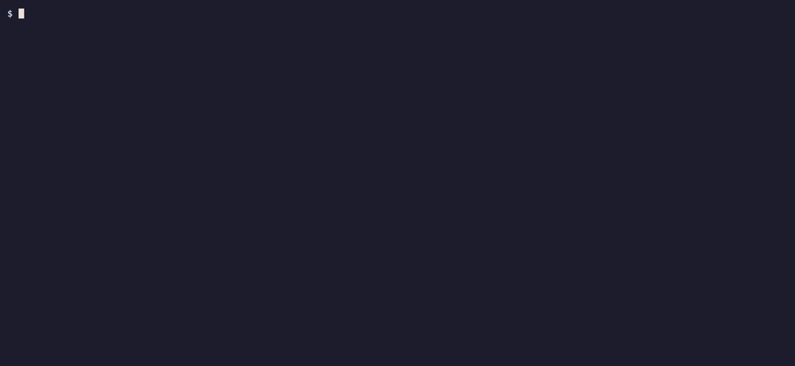

[](https://crates.io/crates/redacter)


# Redacter

Detect & Redact cli tool to find sensitive data in files, such as personal information (PII), passwords, API keys and
other secrets, and to securely copy and redact files removing it, across various sources and destinations and utilising
Data Leak/Loss Prevention (DLP) capabilities.
`redacter cp` copies files and redacts them on the way; `redacter scan` only reads them and reports what was found and
where, with an exit code a CI pipeline can gate on.

The tool ships three redacters that run entirely on your machine, a rule-based one with checksum validation, a small
multilingual named-entity model and a zero-shot span model that looks for labels you choose, and can also delegate to
cloud DLP services and LLMs such as Google Cloud Platform's DLP API. Local redaction keeps the data on the host and
costs nothing per file. See [Local or cloud](#local-or-cloud-quality-versus-performance) for the measured recall and
speed of every redacter.



## Features

* **Copy & Redact:**  copy files while applying DLP redaction to protect sensitive information.
* **Scan:** detect sensitive information in files without changing them, with the same providers, and report what was
  found and where as text or JSON. See [Scan command](#scan-command).
* **Multiple Sources & Destinations:** interact with:
    * Local filesystem
    * Google Cloud Storage (GCS)
    * Amazon Simple Storage Service (S3)
    * Zip files
    * Clipboard (text content and images)
* **DLP Integration:**
    * [Google Cloud Platform DLP](https://cloud.google.com/security/products/dlp?hl=en) for accurate and customizable
      redaction for:
        * text, html, json files
        * structured data table files (csv)
        * images (jpeg, png, bpm, gif)
        * PDF files (rendering as images)
    * [Presidio](https://github.com/data-privacy-stack/presidio) for PII redaction, with no built-in secret detection
      (open source project, maintained by Data Privacy Stack, that you can install on-prem).
        * text, html, csv, json files
        * images
        * PDF files (rendering as images)
    * [GCP Vertex AI](https://cloud.google.com/vertex-ai/docs) based redaction using any available models such as
      Gemini, Claude, etc.:
        * text, html, csv, json files
        * images, redacted by the model itself or by blacking out the coordinates it reports
        * PDF files (rendering as images)
    * [Google Gemini API](https://ai.google.dev/) based redaction
        * text, html, csv, json files
        * images, redacted by the model itself or by blacking out the coordinates it reports
        * PDF files (rendering as images)
    * [Open AI LLM](https://openai.com/) based redaction
        * text, html, csv, json files
        * images, redacted by the model itself or by blacking out the coordinates it reports
        * PDF files (rendering as images)
    * [AWS Comprehend](https://aws.amazon.com/comprehend/) PII redaction:
        * text, html, csv, json files
        * images through text extraction using OCR
        * PDF files (rendering as images from OCR)
    * Local rules redacter: offline regex and checksum based redaction of emails, phone numbers,
      payment cards, IBANs, network addresses, secrets, national identifiers of 43 countries,
      postcodes and dates of birth, plus your own regex and dictionary rules. No cloud account needed.
    * Local NER redacter: offline detection of people, organisations and locations with a
      multilingual transformer model running on your CPU. No cloud account needed:
        * text, html, csv, json files
        * images through text extraction using OCR
        * PDF files (rendering as images from OCR)
    * Local GLiNER redacter: offline, zero-shot span detection against free-text labels you
      choose, understanding context that `local-ner` cannot. No cloud account needed:
        * text, html, csv, json files
        * images through text extraction using OCR
        * PDF files (rendering as images from OCR)
    * Local credential ML redacter: offline detection of passwords, API keys and tokens with a
      line classifier running on your CPU, for the secrets that `local-rules` has no pattern for.
      No cloud account needed:
        * text, html, csv, json files
        * images through text extraction using OCR
        * PDF files (rendering as images from OCR)
    * [AWS Bedrock](https://aws.amazon.com/bedrock/) based redaction using Amazon Nova and other models available on Bedrock
        * text, html, csv, json files
        * images, redacted by blacking out the coordinates the model reports
        * PDF files (rendering as images)
    * [AWS Bedrock Guardrails](https://aws.amazon.com/bedrock/guardrails/) based redaction
        * text, html, csv, json files
    * ... more DLP providers can be added in the future.
* **CLI:**  Easy-to-use command-line interface for streamlined workflows.
* Built with Rust to ensure speed, safety, and reliability.

## What each redacter finds

Sensitive data here means two things: personal information (PII), such as names, addresses, phone numbers and national
identifiers, and secrets, meaning credentials such as passwords, API keys, access tokens, private keys and connection
strings that carry a password. The redacters differ most on secrets.

| Redacter | Personal information | Secrets |
|---|---|---|
| `local-rules` | Emails, phone numbers, payment cards, IBANs, network addresses, national identifiers of 43 countries, postcodes and dates of birth, all by shape and checksum | Passwords and keys written as `key=value`, `key: value` or JSON fields; AWS, Google, GitHub, GitLab, Slack, Stripe, OpenAI, Anthropic, npm, SendGrid, Discord and Hugging Face credentials; JWTs; `Authorization` header values; passwords in URLs; private key blocks. A password written in prose is not found |
| `local-ner` | People, organisations and locations | None |
| `local-gliner` | The labels you choose, 14 PII labels by default | None with the default labels. Chain `local-rules` for secrets |
| `local-credential-ml` | None | Lines that a model rates as holding a credential, with the value on each line redacted: a password written in a sentence, a token with no known prefix, an OAuth client secret after a label, a `.netrc` password. It rates the AWS documentation example keys and `password: value` lines with a plain value low, and `local-rules` finds those. Chain it after `local-rules` |
| `gcp-dlp` | 13 info types, such as names, emails, phone numbers, cards, IBANs, passports and dates of birth | 15 info types: passwords, auth tokens, AWS credentials, basic auth headers, OAuth client secrets, GCP API keys, encryption keys, JWTs, HTTP cookie headers and the credential types of GCP, Azure, OpenAI and Anthropic, signed storage URLs and Tink keysets. In a test with synthetic values it found passwords, JWTs and cookie headers, and missed private key blocks and most vendor tokens |
| `aws-comprehend` | Every Comprehend PII entity type, English text only | Passwords, AWS access keys and secret keys, PINs and usernames. It may redact only part of another token and leave the rest in place |
| `aws-bedrock-guardrails` | The PII types the guardrail enables | Passwords, AWS keys, PINs and usernames when the guardrail enables them, plus any shape you add as a regex filter. It may redact only part of another token |
| `presidio` | Presidio's default recognizers | None built in. Custom recognizers are added on the Presidio side |
| `gcp-vertex-ai`, `gemini-llm`, `open-ai-llm`, `aws-bedrock` | Whatever the model recognises as personal information | Passwords, API keys, access tokens and private keys in text, as the prompt asks. In an image test, Gemini located the secrets of a `.env` screenshot, and Amazon Nova's boxes missed them, which is a limit of the model |

Models answer differently from run to run, so check the output of an LLM redacter before relying on it. To cover both
kinds of data, chain redacters: for a text file, `-d local-rules -d gcp-dlp` redacts the secrets and the pattern-shaped
PII locally before the rest is sent to GCP DLP. GCP DLP reads an image, or a PDF rendered to page images, natively, so
those go to it whole, see [Multiple redacters](#multiple-redacters).

## Installation

### Install script

On macOS, Linux and FreeBSD:

```sh
curl -fsSL https://raw.githubusercontent.com/abdolence/redacter-rs/master/install.sh | sh
```

On Windows (PowerShell):

```powershell
irm https://raw.githubusercontent.com/abdolence/redacter-rs/master/install.ps1 | iex
```

The scripts pick the archive for your operating system and architecture from the latest release
and verify it against the SHA-256 digest GitHub records for it; nothing is installed if the digest
is missing or does not match, or if the downloaded binary does not run on your system. Running a
script again upgrades redacter in place. The Linux x86_64 and aarch64 archives are built for glibc;
on musl systems such as Alpine use [Cargo](#cargo).

* `REDACTER_INSTALL_DIR`: the install directory. Default is `~/.local/bin` on macOS, Linux and FreeBSD
  and `%LOCALAPPDATA%\Programs\redacter` on Windows;
* `REDACTER_VERSION`: the release tag to install, such as `v0.21.0`. Default is the latest release.

The Windows script adds the install directory to your user `PATH`; the shell script prints the
`export` line to add if the directory is not on your `PATH`.

To install a specific version on macOS, Linux and FreeBSD:

```sh
curl -fsSL https://raw.githubusercontent.com/abdolence/redacter-rs/master/install.sh | env REDACTER_VERSION=v0.21.0 sh
```

On Windows:

```powershell
& { try { $env:REDACTER_VERSION = 'v0.21.0'; irm https://raw.githubusercontent.com/abdolence/redacter-rs/master/install.ps1 | iex } finally { Remove-Item Env:REDACTER_VERSION } }
```

To install into a custom directory on macOS, Linux and FreeBSD:

```sh
curl -fsSL https://raw.githubusercontent.com/abdolence/redacter-rs/master/install.sh | env REDACTER_INSTALL_DIR=$HOME/bin sh
```

On Windows:

```powershell
& { try { $env:REDACTER_INSTALL_DIR = 'C:\Tools\redacter'; irm https://raw.githubusercontent.com/abdolence/redacter-rs/master/install.ps1 | iex } finally { Remove-Item Env:REDACTER_INSTALL_DIR } }
```

### Binary releases

Download the latest release from [the GitHub releases](https://github.com/abdolence/redacter-rs/releases).

The Linux x86_64 and aarch64 archives need glibc 2.18 or newer; the Linux arm archive is static (musl) and needs no glibc.

### Cargo

```sh
cargo install redacter
```

### Optional capabilities installation

PDF redaction, OCR (for the DLP providers that can't read images) and the `local-ner`, `local-gliner` and
`local-credential-ml` redacters need addons that are not bundled with the tool. Install the ones you need with
`redacter addons install`, see [Addons](#addons).

## Command line options

Copy and redact files from a source to a destination.

```
Usage: redacter cp [OPTIONS] <SOURCE> <DESTINATION>

Arguments:
  <SOURCE>
          Source directory or file such as /tmp, /tmp/file.txt or gs://bucket/file.txt and others supported providers

  <DESTINATION>
          Destination directory or file such as /tmp, /tmp/file.txt or gs://bucket/file.txt and others supported providers

Options:
  -m, --max-size-limit <MAX_SIZE_LIMIT>
          Maximum size of files to copy in bytes

      --addons-dir <ADDONS_DIR>
          Directory holding the addons that `addons install` installs and manually placed copies, one subdirectory per addon. Overrides the REDACTER_ADDONS_DIR environment variable. Default is the user cache directory, for example ~/.cache/redacter/addons

  -n, --max-files-limit <MAX_FILES_LIMIT>
          Maximum number of files to copy. Sort order is not guaranteed and depends on the provider

  -f, --filename-filter <FILENAME_FILTER>
          Filter by name using glob patterns such as *.txt

  -d, --redact <REDACT>
          List of redacters to use
          
          [possible values: gcp-dlp, aws-comprehend, presidio, gemini-llm, open-ai-llm, gcp-vertex-ai, aws-bedrock, aws-bedrock-guardrails, local-rules, local-ner, local-gliner, local-credential-ml]

      --allow-unsupported-copies
          Allow unsupported types to be copied without redaction

      --unsupported-as-text
          Read files of a type no redacter supports, such as .env files, keys and source code, as text when they are valid UTF-8 without NUL bytes

      --gcp-project-id <GCP_PROJECT_ID>
          GCP project id that will be used to redact and bill API calls

      --gcp-dlp-built-in-info-type <GCP_DLP_BUILT_IN_INFO_TYPE>
          Additional GCP DLP built in info types for redaction

      --gcp-dlp-stored-info-type <GCP_DLP_STORED_INFO_TYPE>
          Additional GCP DLP user defined stored info types for redaction

      --llm-image-mode <LLM_IMAGE_MODE>
          How LLM redacters redact images: 'native' lets the model edit the image, 'coords' asks the model for coordinates and blacks them out locally, 'auto' edits natively then verifies the edit with the coordinate pass, falling back to coordinates entirely when the model cannot edit images

          Possible values:
          - auto:   Edit the image with the model, verify the edit with the coordinate pass, and fall back to coordinates entirely when the model cannot edit images
          - native: Always edit the image with the model, failing when it cannot
          - coords: Always ask the model where the sensitive data is and black it out locally
          
          [default: auto]

      --gcp-region <GCP_REGION>
          GCP location for Vertex AI. Default is 'global'; 'us' and 'eu' multi-regions and regional locations such as 'us-central1' are accepted

      --gcp-vertex-ai-text-model <GCP_VERTEX_AI_TEXT_MODEL>
          Model name for text redaction in Vertex AI, also used to locate sensitive data in images. Default is 'publishers/google/models/gemini-3.8-flash'

      --gcp-vertex-ai-image-model <GCP_VERTEX_AI_IMAGE_MODEL>
          Model name for native image editing in Vertex AI. Default is 'publishers/google/models/gemini-3.1-flash-image'

      --gcp-vertex-ai-block-none-harmful
          Block none harmful content threshold for Vertex AI redacter. Default is BlockOnlyHigh since BlockNone is required a special billing settings.

      --csv-headers-disable
          Disable CSV headers (if they are not present)

      --csv-delimiter <CSV_DELIMITER>
          CSV delimiter (default is ',')

      --aws-region <AWS_REGION>
          AWS region for the AWS Comprehend and AWS Bedrock redacters

      --aws-bedrock-text-model <AWS_BEDROCK_TEXT_MODEL>
          Bedrock model id for text redaction, also used to locate sensitive data in images and, since Bedrock has no active image editing model, to redact images. Default is 'amazon.nova-2-lite-v1:0' with the inference profile prefix of the selected region ('us.', 'eu.' or 'jp.'), falling back to the 'global.' profile elsewhere

      --aws-bedrock-guardrail-id <AWS_BEDROCK_GUARDRAIL_ID>
          Guardrail id for the AWS Bedrock Guardrails redacter

      --aws-bedrock-guardrail-version <AWS_BEDROCK_GUARDRAIL_VERSION>
          Guardrail version for the AWS Bedrock Guardrails redacter. Default is 'DRAFT'

      --presidio-text-analyze-url <PRESIDIO_TEXT_ANALYZE_URL>
          URL for text analyze endpoint for Presidio redacter

      --presidio-image-redact-url <PRESIDIO_IMAGE_REDACT_URL>
          URL for image redact endpoint for Presidio redacter

      --gemini-model <GEMINI_MODEL>
          Gemini model name for text redaction, also used to locate sensitive data in images. Default is 'models/gemini-3.8-flash'

      --gemini-image-model <GEMINI_IMAGE_MODEL>
          Gemini model name for native image editing. Default is 'models/gemini-3.1-flash-image'

      --sampling-size <SAMPLING_SIZE>
          Sampling size in bytes before redacting files. Disabled by default

      --open-ai-api-key <OPEN_AI_API_KEY>
          API key for OpenAI LLM redacter

      --open-ai-model <OPEN_AI_MODEL>
          Open AI chat model name for text redaction, also used to locate sensitive data in images. Default is 'gpt-5.6-luna'

      --open-ai-image-model <OPEN_AI_IMAGE_MODEL>
          Open AI model name for native image editing. Default is 'gpt-image-2'

      --limit-dlp-requests <LIMIT_DLP_REQUESTS>
          Limit the number of DLP requests. Some DLPs has strict quotas and to avoid errors, limit the number of requests delaying them. Default is disabled

      --local-rules <LOCAL_RULES>
          Rule groups enabled for the local-rules redacter, comma separated. Default is every group
          
          [possible values: email, phone, payment-card, iban, network, url, secrets, us-identifiers, eu-identifiers, world-identifiers, postcodes, birth-dates, custom]

      --local-rules-disable <LOCAL_RULES_DISABLE>
          Rule groups disabled for the local-rules redacter, comma separated. Applied after --local-rules
          
          [possible values: email, phone, payment-card, iban, network, url, secrets, us-identifiers, eu-identifiers, world-identifiers, postcodes, birth-dates, custom]

      --local-rule <LOCAL_RULE>
          User-defined regex rule for the local-rules redacter in the form name=regex. Can be repeated

      --local-rules-file <LOCAL_RULES_FILE>
          JSON file with user-defined regex and dictionary rules for the local-rules redacter. Can be repeated

      --local-ner-entities <LOCAL_NER_ENTITIES>
          Entity types the local-ner redacter removes, comma separated: per (people), org (organisations), loc (locations). Default is all three
          
          [possible values: per, org, loc]

      --local-ner-min-score <LOCAL_NER_MIN_SCORE>
          Minimum model confidence for a word to be redacted by local-ner, between 0 and 1. Lower values redact more. Default is 0.5
          
          [default: 0.5]

      --local-gliner-labels <LOCAL_GLINER_LABELS>
          Entity labels the local-gliner redacter looks for, comma separated, free text understood by the model (for example "person,email,medical condition"). Default is a PII list: person, address, email, phone number, date of birth, passport number, national id number, credit card number, iban, ip address, username, medical condition, postal code, license plate number

      --local-gliner-min-score <LOCAL_GLINER_MIN_SCORE>
          Minimum model confidence for a span to be redacted by local-gliner, between 0 and 1. Lower values redact more. Default is 0.5
          
          [default: 0.5]

      --local-credential-ml-min-score <LOCAL_CREDENTIAL_ML_MIN_SCORE>
          Minimum model confidence for a line to be redacted by local-credential-ml, between 0 and 1. Lower values redact more. Default is 0.74, the model card's threshold
          
          [default: 0.74]

      --mime-override <MIME_OVERRIDE>
          Override media type detection using glob patterns such as 'text/plain=*.md'

      --report-file <REPORT_FILE>
          Write the report to this file

      --report-format <REPORT_FORMAT>
          Format of the report file: 'json' for machines, 'text' for people. Requires --report-file. Default is 'json'
          
          [default: json]
          [possible values: json, text]

  -h, --help
          Print help (see a summary with '-h')
```

DLP is optional and should be enabled with `--redact` (`-d`) option.
Without DLP enabled, the tool will copy all files without redaction.
With DLP enabled, the tool will redact files based on the DLP model and skip unsupported files.

`--report-file` saves the result of the command to a file: `files_copied`, `files_redacted` and `files_skipped`
as JSON by default, or the same three counts as text with `--report-format text`. The terminal output is the same
with or without it. `--report-file` and `--report-format` replace `--save-json-results`, which
is no longer accepted. `scan` takes the same two options, see [Scan command](#scan-command).

## Source and destinations

Source/destination can be a local file or directory, or a file in GCS, S3, and others:

- Local file: `/tmp/file.txt` or `/tmp` for whole directory recursive copy
- GCS: `gs://bucket/file.txt` or `gs://bucket/test-dir/` for whole directory recursive copy
- S3: `s3://bucket/file.txt` or `s3://bucket/test-dir/` for whole directory recursive copy
- Zip archive: `zip://tmp/archive.zip`
- Clipboard: `clipboard://`

## DLP and redacters

### Google Cloud Platform DLP

To be able to use GCP DLP you need to:

- authenticate using `gcloud auth application-default login` or provide a service account key
  using `GOOGLE_APPLICATION_CREDENTIALS` environment variable.
- provide a GCP project id using `--gcp-project-id` option.

Additionally you can provide the list of user defined info types using `--gcp-dlp-stored-info-type` option.

The built-in info types sent by default cover personal information and credentials. `--gcp-dlp-built-in-info-type`
adds more, see the [infoTypes reference](https://docs.cloud.google.com/sensitive-data-protection/docs/infotypes-reference).

### Presidio

Presidio's default recognizers find personal information only. To find secrets, add custom recognizers on the Presidio
side.

To be able to use Presidio you need to have a running instance of the Presidio API.
The project is maintained by [Data Privacy Stack](https://github.com/data-privacy-stack) and publishes the
analyzer and the image redactor as container images. You can run them locally or deploy them to your infrastructure:

```sh
docker run -d -p 5002:3000 ghcr.io/data-privacy-stack/presidio-analyzer:latest
docker run -d -p 5003:3000 ghcr.io/data-privacy-stack/presidio-image-redactor:latest
```

You need to provide the URLs for text analysis and image redaction endpoints using `--presidio-text-analyze-url` and
`--presidio-image-redact-url` options.

The `ms-presidio` redacter name and the `--ms-presidio-*` options still work, but are deprecated and print a warning.

### GCP Vertex AI

Vertex AI redacter supports any available models on GCP Vertex AI Models Garden, such as:

- Google Gemini
- Claude
- etc.

Default models are set to Gemini models.

To be able to use GCP Vertex AI you need to:

- authenticate using `gcloud auth application-default login` or provide a service account key
  using `GOOGLE_APPLICATION_CREDENTIALS` environment variable.
- provide a GCP project id using `--gcp-project-id` option.

The location is optional and defaults to `global`. Use `--gcp-region` to pick another one: the `us` and `eu`
multi-regions and regional locations such as `us-central1` are accepted. Note that the Gemini 3.x models are
served only on `global`, `us` and `eu`.

You can specify different models using `--gcp-vertex-ai-text-model` and `--gcp-vertex-ai-image-model` options.
By default, they are set to:

- `publishers/google/models/gemini-3.8-flash` for the text model
- `publishers/google/models/gemini-3.1-flash-image` for the image model

### Google Gemini API

To be able to use the Gemini API redacter you need to authenticate with credentials that carry the
`https://www.googleapis.com/auth/generative-language` scope and provide a GCP project id using `--gcp-project-id`.
Models are selected with `--gemini-model` (default `models/gemini-3.8-flash`) and `--gemini-image-model`
(default `models/gemini-3.1-flash-image`).

### Open AI LLM

To be able to use Open AI LLM you need to provide an API key using `--open-ai-api-key` command line option.
Optionally, you can provide model names using `--open-ai-model` (default `gpt-5.6-luna`) and
`--open-ai-image-model` (default `gpt-image-2`) options.

### Image redaction with LLM redacters

GCP Vertex AI, Gemini API and Open AI redact images in one of two ways, selected with
`--llm-image-mode`; AWS Bedrock has no active image editing model and always redacts images by
coordinates, so `--llm-image-mode native` is rejected for it:

- `native` (the image model edits the image and returns it with the sensitive data covered by black boxes);
- `coords` (the text model reports the coordinates of the sensitive data and the tool blacks them out locally);
- `auto` (the default): the native path is tried first and its result is then verified by running the coordinate
  path over the edited image, blacking out anything the model left legible; the tool falls back to coordinates
  entirely when the model cannot edit images. Authentication, permission and quota errors are never retried.

### AWS Comprehend

To be able to use AWS Comprehend DLP you need to authenticate using `aws configure` or provide a service account.
To provide an AWS region use `--aws-region` option since AWS Comprehend may not be available in all regions.
AWS Comprehend DLP is only available for unstructured text files.

### AWS Bedrock

To be able to use AWS Bedrock you need to authenticate using `aws login`, `aws configure` or a service account,
and have model access enabled for the models you use in the Bedrock console.
To provide an AWS region use `--aws-region` option.

The text model is used for text redaction and to locate sensitive data in images; AWS Bedrock has no active
image editing model, so images are always redacted by that coordinate path (`--llm-image-mode native` is
rejected for this redacter). Select the model with `--aws-bedrock-text-model`; by default it is
`amazon.nova-2-lite-v1:0`. Amazon Nova 2 Lite has no in-region endpoint and is served only through Geo
inference profiles, so the default id is prefixed with the geography of the selected region (`us.`, `eu.`, or
`jp.` for `ap-northeast-1`/`ap-northeast-3`). Outside the US, EU and Japan the default falls back to the
`global.` profile, which may route the request to another geography; pass an explicit id to
`--aws-bedrock-text-model` to override it.

Text redaction works with any Converse-capable model id. Images are redacted with Amazon Nova (the default) or
Anthropic Claude models, detected from the model id; any other model family is rejected for image redaction
with an error rather than risking misplaced boxes.

### AWS Bedrock Guardrails

This redacter sends text to the [`ApplyGuardrail`](https://aws.amazon.com/bedrock/guardrails/) API of a guardrail
you own, and returns the anonymized text the service produces. Placeholders such as `{NAME}`, `{EMAIL}` or
`{PHONE}` that the guardrail inserts in place of the sensitive values are kept as-is in the output. Only text-based
formats are supported (text, html, csv, json); images and PDFs are not.

To be able to use it you need to authenticate the same way as for AWS Bedrock (`aws login`, `aws configure` or a
service account), provide an AWS region using `--aws-region`, and pass the id of a guardrail you own using
`--aws-bedrock-guardrail-id`. Use `--aws-bedrock-guardrail-version` to pick a specific published version; the
default is `DRAFT`.

The guardrail's sensitive information filters must be configured with the action **Anonymize**. If a filter is
instead configured to **Block**, the service returns the guardrail's blocked message instead of redacted text, and
the tool rejects the response rather than returning that message as if it were redacted content.

You can create a guardrail with its sensitive information filters set to anonymize using the AWS CLI. For example, with
a `guardrail-pii.json` file such as:

```json
{
  "piiEntitiesConfig": [
    {"type": "NAME", "action": "ANONYMIZE", "inputAction": "ANONYMIZE", "outputAction": "ANONYMIZE", "inputEnabled": true, "outputEnabled": true},
    {"type": "EMAIL", "action": "ANONYMIZE", "inputAction": "ANONYMIZE", "outputAction": "ANONYMIZE", "inputEnabled": true, "outputEnabled": true},
    {"type": "PHONE", "action": "ANONYMIZE", "inputAction": "ANONYMIZE", "outputAction": "ANONYMIZE", "inputEnabled": true, "outputEnabled": true},
    {"type": "ADDRESS", "action": "ANONYMIZE", "inputAction": "ANONYMIZE", "outputAction": "ANONYMIZE", "inputEnabled": true, "outputEnabled": true},
    {"type": "CREDIT_DEBIT_CARD_NUMBER", "action": "ANONYMIZE", "inputAction": "ANONYMIZE", "outputAction": "ANONYMIZE", "inputEnabled": true, "outputEnabled": true},
    {"type": "PASSWORD", "action": "ANONYMIZE", "inputAction": "ANONYMIZE", "outputAction": "ANONYMIZE", "inputEnabled": true, "outputEnabled": true},
    {"type": "AWS_ACCESS_KEY", "action": "ANONYMIZE", "inputAction": "ANONYMIZE", "outputAction": "ANONYMIZE", "inputEnabled": true, "outputEnabled": true},
    {"type": "AWS_SECRET_KEY", "action": "ANONYMIZE", "inputAction": "ANONYMIZE", "outputAction": "ANONYMIZE", "inputEnabled": true, "outputEnabled": true}
  ],
  "regexesConfig": [
    {"name": "github-token", "pattern": "gh[pousr]_[A-Za-z0-9]{36}", "action": "ANONYMIZE", "inputAction": "ANONYMIZE", "outputAction": "ANONYMIZE", "inputEnabled": true, "outputEnabled": true}
  ]
}
```

The built-in types cover passwords, AWS keys, PINs and usernames only. A regex filter covers the shape of any other secret, such as the
GitHub token above. See the [AWS documentation](https://docs.aws.amazon.com/bedrock/latest/userguide/guardrails-sensitive-filters.html)
for the full list of supported PII entity types. Create the guardrail with:

```sh
aws bedrock create-guardrail --region eu-north-1 --name redacter-pii \
  --blocked-input-messaging "Blocked by guardrail" --blocked-outputs-messaging "Blocked by guardrail" \
  --sensitive-information-policy-config file://guardrail-pii.json
```

### Local rules redacter

The `local-rules` redacter runs entirely on your machine. It finds pattern-shaped personal information
and secrets with curated regular expressions and checksum validators (Luhn for payment cards, mod-97 for IBANs,
national checks for identifiers) and replaces each match with `[REDACTED]`. With `redacter scan` it reports
the matches instead, labelled with the name of the rule, see [Scan command](#scan-command).

On an image or a PDF, the file first goes through the OCR engine: every word it recognises is passed
to the redacter (and, with more than one `-d`, to the whole chain in turn) as if it were reading the
page as text, and every word the chain changes is blacked out on a rasterised copy of the page — the
output PDF or image carries no text layer for the original words to survive in.

Built-in rule groups, all enabled by default:

| Group | Contents |
|---|---|
| `email` | Email addresses |
| `phone` | International (`+`, `00`) and national phone numbers |
| `payment-card` | Payment card numbers (Luhn) |
| `iban` | IBANs (mod 97 and the national length) |
| `network` | IPv4, IPv6 and MAC addresses |
| `url` | Credentials embedded in URLs |
| `secrets` | Passwords and keys in `key=value` lines; AWS, GCP, GitHub, GitLab, Slack, Stripe, OpenAI, Anthropic, npm, SendGrid, Discord and Hugging Face credentials; JWTs; authorization headers; PEM and PGP private keys |
| `us-identifiers` | SSN and ITIN, passport numbers next to the word passport (in 9 languages), US driver's license numbers |
| `eu-identifiers` | European identifiers: the national personal numbers of Albania, Austria, Belgium, Bosnia and Herzegovina, Bulgaria, Croatia, Czechia, Denmark, Estonia, Finland, France, Germany (Steuer-ID), Greece (AMKA and AFM), Hungary (személyi szám and TAJ), Iceland, Ireland, Italy, Latvia, Lithuania, Luxembourg, Malta, Montenegro, the Netherlands, North Macedonia, Norway, Poland, Portugal, Romania, Serbia, Slovakia, Slovenia, Spain, Sweden, Switzerland, Turkey and the United Kingdom (NINO and driving licence), plus EU VAT numbers |
| `world-identifiers` | Canadian SIN, Australian TFN, Brazilian CPF, Indian Aadhaar, South African ID, Chinese resident ID |
| `postcodes` | UK postcodes, Irish Eircodes, Canadian postal codes |
| `birth-dates` | Dates of birth next to a birth keyword (`date of birth`, `Geburtsdatum`, `né le`, `fecha de nacimiento`, ...) in English, German, French, Spanish, Italian, Dutch, Portuguese, Polish and Swedish |

`eu-identifiers` covers the whole of Europe including the Nordics, Baltics, Balkans, Switzerland, Turkey
and the UK. Every rule with its check, whether it needs a context word, and an example is listed in
[docs/local-rules.md](docs/local-rules.md). Each identifier is verified with its published check digit
and, where the number embeds one, its birth date. Not covered, because the country publishes no format
or no check digit for its personal number: Cyprus, Liechtenstein, Monaco, Andorra, San Marino, Vatican
City and Kosovo; Ukraine, Moldova and Belarus are out of scope.

Identifiers whose check digit alone would accept too many ordinary numbers (Danish CPR, Portuguese NIF,
Greek AFM, Hungarian TAJ, Croatian OIB, Turkish TCKN, a bare Brazilian CPF, Canadian SIN, Australian TFN,
Indian Aadhaar) and shapes without a check (passports, driving licences, dates of birth, Albanian and
Maltese ids) are only redacted within 20 characters (30 for dates of birth) of a context word such as
`CPR`, `NIF`, `passport` or `date of birth`, in the local language. The keyword has to be in the same
text unit: a CSV cell is redacted on its own, so a column of bare CPFs under a `cpf` header is not found
while the written `NNN.NNN.NNN-NN` form is.

```sh
# Only emails and phone numbers
redacter cp -d local-rules --local-rules email,phone tmp/source/ tmp/redacted/

# Everything except the EU identifiers
redacter cp -d local-rules --local-rules-disable eu-identifiers tmp/source/ tmp/redacted/
```

You can add your own rules, similar to custom info types in GCP DLP, either inline or from a JSON file:

```sh
redacter cp -d local-rules --local-rule 'employee-id=\bEMP-[0-9]{6}\b' --local-rules-file rules.json ...
```

```json
{
  "rules": [
    { "name": "employee-id", "regex": "\\bEMP-[0-9]{6}\\b" },
    { "name": "project-codenames", "dictionary": ["Bluebird", "Kestrel"], "case_insensitive": true }
  ]
}
```

A rule has exactly one of `regex` or `dictionary`. Dictionary words match as whole words and are
case-insensitive unless `case_insensitive` is `false`. Rule names must be unique. User-defined rules
always run: they are not one of the switchable groups, so `--local-rules-disable custom` does not
suppress them; drop the `--local-rule` and `--local-rules-file` options instead.

The local rules redacter does not detect names, addresses or organisations, and it only matches
pattern-shaped values. Combine it with a cloud redacter to cover names and addresses, for example
`-d local-rules -d gcp-dlp` removes the pattern-shaped data locally before the remainder is sent to GCP
DLP. It works natively on text, html, json and csv files, and handles images and PDFs the same way the
AWS Comprehend redacter does: images through text extraction using OCR, blacking out the words the rules
matched, and PDF files by rendering them as images first. Both need the optional capabilities installed
(the OCR models, and Pdfium for PDFs); without them images and PDFs are skipped unless
`--allow-unsupported-copies` is set.

A password or key written as `key=value`, `key: value` or a JSON field is redacted when the key ends in a word such as
`password`, `secret`, `token`, `api_key` or `private_key`, and the value has at least 8 characters with a digit or one
of `!@#%^&*+=?~` among them. The key name stays. A quoted value ends at the next quote of the kind that opened it,
single, double or backtick, and may hold spaces, commas, semicolons, the other two quote kinds, escaped quotes such as
`\"` and, in a single-quoted value, the SQL and YAML doubled quote `''`. JSON written inside a JSON string, where the
quotes are `\"`, is redacted as well. A value in braces directly after the `=`, such as the ODBC `Pwd={Sup3r;S3cret1}`,
is redacted and the braces stay. An unquoted value ends at a space, comma, semicolon, quote, `<`, a closing bracket
(`)`, `]`, `}` or `>`) or an `&` that starts a `name=` pair, so in `?token=abc123def456&user=alice` only the token is
redacted.

Some values are taken for references or placeholders and left alone:

- a quoted value starting with whitespace, `<`, `$`, `%`, `*`, `[` or `{`;
- an unquoted value starting with `$`, `%`, `*`, `&`, `:`, `<`, `>`, `(`, `)`, `[`, `]`, `{` or `}`;
- an unquoted value that is a dotted or `::` path of identifiers, such as `process.env.API_KEY_V2` or
  `crate::signing::private_key::Key`, unless one segment has more than 32 characters or every segment mixes letters
  and digits, as in `abcdefgh1234.ijklmnop5678`.

Known misses: a value of letters only, such as `password: my-secret-pass`; a password starting with a listed character,
such as `password=$ecretPa55word`; an unquoted password written as a dotted path, such as `password: john.smith2024`;
a password written in a sentence; and a quoted value that does not close on its line, such as `password = "Sup3rS3cret1`
at a cut-off line end, a YAML `>-` block or a `"""` triple-quoted string.

Known over-redactions: a value that names a secret instead of holding it, such as the Terraform
`secret = "ip2location-token"` that points to a Secret Manager secret, and any other literal with a digit or a symbol
after such a key, such as `token: v2-beta-channel`; and a file path after such a key, such as
`PWD=/home/runner/work/app2` or `secret: /run/secrets/db_password1`, because one base64 secret in 64 starts with `/`.

Matching on shape alone over-redacts in places. The known cases: a number of 13 to 19 digits starting
with 3 to 6 that passes the Luhn check is taken for a payment card, which also catches the rarer case of
a 13-digit EAN barcode starting with 3 to 6 whose own check digit happens to pass Luhn too
(`--local-rules-disable payment-card` is the lever for either); a national phone number written with
a leading `0` is any 9 to 12 digits in 2 to 5 groups, which also fits some reference numbers; any 6 to 9
digit number within 20 characters of the word `passport` is taken for a passport number; and national
identifiers without a keyword are accepted on their check digit and embedded date alone, so a bare
10-digit run of digits has about a 2% chance and an 11-digit run about 1.5% of passing one of the
checksummed rules. For a document that is mostly numbers, `--local-rules-disable eu-identifiers` (or
disabling the specific groups that don't apply) is the lever to pull.

### Local NER redacter

The `local-ner` redacter finds names of people (`per`), organisations (`org`) and locations (`loc`)
with a multilingual named-entity model running entirely on your machine, and replaces each of them
with `[REDACTED]`. It uses the `distilbert-base-multilingual-cased-ner-hrl` model, trained on ten
high-resource languages: Arabic, German, English, Spanish, French, Italian, Latvian, Dutch,
Portuguese and Chinese. Nothing leaves your computer; the only network access is
`redacter addons install local-ner`, which installs the model files described in [Addons](#addons).

Like `local-rules`, an image or a PDF first goes through the OCR engine: every recognised word is
passed to the model as if it were reading the page as text, and every word the chain redacts is
blacked out on a rasterised copy of the page.

```sh
# People, organisations and locations, the default
redacter cp -d local-ner tmp/source/ tmp/redacted/

# Only people, and redact more aggressively
redacter cp -d local-ner --local-ner-entities per --local-ner-min-score 0.3 tmp/source/ tmp/redacted/

# Pattern-shaped data by rules, names by the model, all offline
redacter cp -d local-rules -d local-ner tmp/source/ tmp/redacted/
```

Use a release binary (or `cargo run --release`) for `local-ner`: a debug build spends about 12
seconds per 512-token window of text, against about 95 ms in release. In release, loading the model
takes about 100 ms and it holds about 232 MiB of peak memory; the download in
[Addons](#addons) is about 131.6 MiB in total. A table costs one forward
pass per cell that holds a letter, so a CSV of many short rows is far slower than a text file of the
same size. These numbers are approximate and depend on your hardware and the amount of text.

`--local-ner-min-score` is the model confidence a word needs to be redacted, between 0 and 1
(default 0.5); lower values redact more and produce more false positives. The model does not detect
dates, emails, phone numbers or identifiers: combine it with `local-rules` for those. Its accuracy is
below the cloud DLP services, and the CPU time grows with the amount of text. It works natively on
text, html, json and csv files, and handles images and PDFs the way the AWS Comprehend redacter does:
through OCR and Pdfium, when those optional capabilities are installed.

A single word with nothing around it carries no context for the model, so a one-word text file may
not be tagged at all; a name in a table cell is scored together with its column header, which is why
a CSV or HTML table column of names is reliably redacted even though each cell is short. The `org`
label also over-redacts occasionally, tagging product and brand names alongside real organisations.

The model is [Xenova/distilbert-base-multilingual-cased-ner-hrl](https://huggingface.co/Xenova/distilbert-base-multilingual-cased-ner-hrl),
the ONNX export by Xenova of [Davlan/distilbert-base-multilingual-cased-ner-hrl](https://huggingface.co/Davlan/distilbert-base-multilingual-cased-ner-hrl)
by David Adelani, released under the [Academic Free License 3.0](https://opensource.org/license/afl-3-0-php).
The model is not bundled with the tool.

### Local GLiNER redacter

The `local-gliner` redacter runs a zero-shot span model entirely on your machine: instead of a fixed
label set, you give it the entity labels to look for as free text, and it scores every span of the
document against each one. It replaces each match with `[REDACTED]`, like the other local redacters.
Unlike `local-ner`, it reads context: it finds a lower-case name with no capitalisation to key off, a
medical condition described in a sentence, a date of birth with no `date of birth` keyword next to it,
and handles and usernames written as free text, none of which `local-rules` or `local-ner` can find on
their own. It uses [`urchade/gliner_multi_pii-v1`](https://huggingface.co/urchade/gliner_multi_pii-v1)
(the [onnx-community](https://huggingface.co/onnx-community/gliner_multi_pii-v1) ONNX export),
trained on six languages: English, French, German, Spanish, Italian and Portuguese. Nothing leaves your
computer; the only network access is `redacter addons install local-gliner`, which installs the model files
described in [Addons](#addons).

Like `local-rules` and `local-ner`, an image or a PDF first goes through the OCR engine: every recognised
word is passed to the model as if it were reading the page as text, and every word the chain redacts is
blacked out on a rasterised copy of the page.

```sh
# The default PII label list
redacter cp -d local-gliner tmp/source/ tmp/redacted/

# Your own labels, and redact more aggressively
redacter cp -d local-gliner --local-gliner-labels "person,email,medical condition" --local-gliner-min-score 0.3 tmp/source/ tmp/redacted/

# Pattern-shaped data by rules, everything else by the context-aware model, all offline
redacter cp -d local-rules -d local-gliner tmp/source/ tmp/redacted/
```

`--local-gliner-labels` is a comma-separated list of free-text labels, understood by the model rather
than looked up in a fixed taxonomy; the default is a PII-only list: person, address, email, phone
number, date of birth, passport number, national id number, credit card number, iban, ip address,
username, medical condition, postal code, license plate number. `organization` is deliberately not in
the default list: measured against this model, it tags team and desk names such as "Marketing team" and
"The Support Desk" as organisations, which is over-redaction for a label most callers do not want on by
default; add it with `--local-gliner-labels` when you do. `--local-gliner-min-score` is the model
confidence a span needs to be redacted, between 0 and 1 (default 0.5); lower values redact more. Scores
are well separated in practice, so lowering the threshold rarely changes the result.

Use a release binary (or `cargo run --release`) for `local-gliner`: like `local-ner`, a debug build is
far slower than release. In release, on an Intel i7-10700K (16 threads), loading the model takes about
0.6 s and it holds about 1.5 GB of peak memory while redacting a small text corpus; the download in
[Addons](#addons) is about 1.17 GB, almost all of it the fp32 model weights
(the int8 export cannot be used: its span head has an operator this tool's ONNX runtime does not
support). The time per file on the benchmark datasets is in [docs/dlp-comparison.md](docs/dlp-comparison.md#speed).
The forward pass takes roughly 100-200 ms per 384-token window. A document
scores each label in batches of at most 25, so more labels cost more passes and, as with
`organization` above, more false positives.

A date that merely looks like a date of birth may still be redacted regardless of context, since the
model has learned the shape as well as the wording -- on the benchmark corpus this catches the invoice
date `14 March 1985` in `dates-en.txt`, which carries no birth-related wording at all. A single word with
nothing around it can still be missed the way it can with `local-ner`, since the model also relies on
context to score a span highly.

The model is Apache-2.0, [`urchade/gliner_multi_pii-v1`](https://huggingface.co/urchade/gliner_multi_pii-v1)
by Urchade Zaratiana, trained on the Apache-2.0
[`urchade/synthetic-pii-ner-mistral-v1`](https://huggingface.co/datasets/urchade/synthetic-pii-ner-mistral-v1)
dataset; its backbone, `microsoft/mdeberta-v3-base`, is MIT licensed. The model is not bundled with the
tool.

### Local credential ML redacter

The `local-credential-ml` redacter finds passwords, API keys and access tokens with a small classifier model
running entirely on your machine. The model reads one line at a time and rates how likely the line is to hold a
credential. The redacter replaces the credential on every line rated 0.74 or more with `[REDACTED]`. It finds
secrets that `local-rules` has no pattern for: a password written in a sentence, a token with no known prefix, an
OAuth client secret after a label, a `.netrc` password. Nothing leaves your computer; the only network access is
`redacter addons install local-credential-ml`, which installs the model files described in [Addons](#addons).

Like `local-rules`, an image or a PDF first goes through the OCR engine, and the recognised text is passed to the
model as if it were a text file.

```sh
# Secrets by rules first, then the secrets the rules missed, found by the model
redacter cp -d local-rules -d local-credential-ml tmp/source/ tmp/redacted/

# Redact more aggressively
redacter cp -d local-rules -d local-credential-ml --local-credential-ml-min-score 0.5 tmp/source/ tmp/redacted/
```

The model says that a line holds a credential and not where, so the values on a line are placed first, and the
line is rated only when there is something to redact:

- the secret rules of `local-rules` run on the line: `key=value` and `key: value` assignments, quoted values of any
  length, vendor tokens, `Authorization` header values and passwords in URLs. Their value checks are off, since the
  model rates the line;
- every word of the line that holds a digit or one of the symbols `!@#%^&*+=?~` is a value too, without the quotes
  around it and without the `key=` in front of it, unless a rule already placed a value in that word. The
  other symbols (`-`, `.`, `/`, `:`, `_` and `$`) do not count, so `api.example.com` is left alone and
  `correct-horse-battery-staple` is never found by this step. A word is split at a redaction marker that an
  earlier redacter left; the marker is never a value, and the text on either side of it can be;
- a line with no value is not rated.

A `-----BEGIN ... PRIVATE KEY-----` block, found by the `private-key-block` rule of `local-rules`, is redacted
whatever the model rates; the lines inside a block are not rated.

The key of an assignment stays in the file. In a table, a cell is rated behind its column header, as
`password: value`, and only the cell is redacted.

`--local-credential-ml-min-score` is the model confidence a line needs, between 0 and 1 (default 0.74, the
threshold of the model card). Lower values redact more and produce more false alarms. Chain it after `local-rules`:
`cp` applies the redacters in the order given, so the model rates the text with the values that rules found
already replaced.

On the `secrets` dataset of the benchmark (41 planted secrets, 19 strings that look like secrets and are not) the
model alone found 25 values at 0.74 and 31 at 0.50. Chained after `local-rules`, which found 36 alone, it found
38 and 40, with no false alarm and no keep string hit at either threshold. Each of the 25 findings at 0.74
covered exactly the planted value. At 0.50, 29 of 30 did, and the other left the `sessionid=` of a cookie in place.
The benchmark is in [docs/dlp-comparison.md](docs/dlp-comparison.md).

Limits:

- the model rates a line on its own, without the lines around it, and reads the first 128 tokens of a line;
- it rates the AWS documentation example keys and `password: value` lines with a plain value low. `local-rules`
  finds both, which is why it is chained;
- every word with a digit or one of `!@#%^&*+=?~` on a flagged line is redacted, so a host name, an IP address or
  a date next to the password is redacted too;
- it found 6 of the 33 credentials of the `public` dataset, and it does not look for personal information;
- on 30,350 non-blank lines of Rust and Markdown source it flagged 32 lines (0.11%) at the default threshold, nearly
  all of them test data that holds passwords and tokens;
- the model takes 4 to 6 ms for a line, and a line with no value is not rated. A scan of Rust source of 30,036
  non-blank lines took 32 s, and a log of 10,000 lines of 100 characters, each holding a digit, took 58 s (5.8 ms a
  line). The process holds 190 to 210 MiB and loading takes about 60 ms. These numbers are from an Apple M6 Mac
  mini that was running other work, with a load average of about 2.4.

The model is [zaindanaharper/credential-line-32m](https://huggingface.co/zaindanaharper/credential-line-32m) by
Zain Dana Harper, released under the MIT licence and fine-tuned from
[jhu-clsp/ettin-encoder-32m](https://huggingface.co/jhu-clsp/ettin-encoder-32m) (MIT, Johns Hopkins University
Center for Language and Speech Processing). Its card reports a precision of 0.92 and a recall of 0.81 on 1,264
human-written lines; these figures are the author's own. The model is not bundled with the tool.

### Local or cloud: quality versus performance

The local redacters run on your machine, so nothing leaves it, nothing is billed and nothing needs credentials.
`presidio` runs where you deploy it. The cloud services and LLMs are billed for what they read, and they receive the
content of the files. The table gives the recall of each redacter on four datasets (recall is the share of the
sensitive values that it found) and the time per file on `public`. A `+` joins redacters given to one scan, such as `-d local-rules -d local-gliner`.

| Redacter | Fixtures | Secrets | Public | Images | Per file on public |
|---|---|---|---|---|---|
| `local-rules` | 54% | 88% | 24% | 62% | under 1 ms |
| `local-ner` | 23% | 0% | 23% | 19% | 39 ms |
| `local-gliner` | 100% | 2% | 55% | 88% | 441 ms |
| `local-rules+local-ner` | 77% | 88% | 46% | 94% | 38 ms |
| `local-rules+local-gliner` | 100% | 88% | 57% | 88% | 466 ms |
| `local-credential-ml` | 0% | 61% | 1% | 0% | 38 ms |
| `local-rules+local-credential-ml` | 54% | 93% | 24% | 62% | 38 ms |
| `presidio` | 69% | 7% | 66% | 69% | 12 ms |
| `gcp-dlp` | 85% | 41% | 49% | 94% | 72 ms |
| `aws-comprehend` | 98% | 56% | 80% | 94% | 84 ms |
| `aws-bedrock-guardrails` | 90% | 46% | 74% | 81% | 161 ms |
| `gcp-vertex-ai` | 98% | 100% | 86% | 100% | 9062 ms |
| `aws-bedrock` | 98% | 93% | 87% | 94% | 583 ms |

Measured on commit `2390a25` on an Apple M6 Mac mini. `fixtures` is 8 text files, `secrets` 29 files with synthetic
secrets, `public` 200 records of [nvidia/Nemotron-PII](https://huggingface.co/datasets/nvidia/Nemotron-PII) (CC BY 4.0)
and `images` a PNG and a PDF of one form. The time per file includes the start of the process and the load of the
models. The `local-credential-ml` rows come from a later run, on commit `c71f738`, with the same datasets. `gemini-llm` and `open-ai-llm` were not measured.

For secrets, `local-rules` found 88% at 1 ms per file, `local-rules+local-credential-ml` 93%, and `gcp-vertex-ai` found all of them. For personal information
in free text, `local-gliner` found every value in `fixtures`, and on `public` `aws-bedrock` (87%), `gcp-vertex-ai` (86%)
and `aws-comprehend` (80%) found the most. To keep the data on the machine, start with `local-rules+local-gliner`. To
find more, chain a cloud redacter after the local pass, see [Multiple redacters](#multiple-redacters).

The local redacters give the same output for the same input, which makes results easy to test and audit.
`local-gliner`'s model is a ~1.17 GB download and needs about 1.5 GB of memory while running, against 132 MB and 232 MB
for `local-ner`. The `local-credential-ml` model is a 126 MiB download and the process holds about 190 MiB.

Precision, recall per category, speed on every dataset, what each redacter sends out, the limits of the measurement and
the commands to reproduce it are in [docs/dlp-comparison.md](docs/dlp-comparison.md).

## Multiple redacters

You can specify multiple redacters using `--redact` option multiple times.
The tool will apply redaction in the order of the redacters specified.
When multiple redacters are specified, the tool first tries to redact the file using the redacters that support input
files natively.
Only if such redacters are not available, the tool will try to redact the file using the redacters using conversions.

`scan` does not chain the redacters: each one reads the original file and reports its own findings.

## PDF redaction

PDF redaction is supported by rendering PDF files as images and redacting them.
To render and convert PDF files the tool uses the external library `Pdfium` (the C++ PDF library used by the Google
Chromium project). `redacter addons install pdf` installs the build the tool is compiled against:

- The library is stored with the other addons, in `<addons dir>/pdfium-7881/`, and is checked against its pinned
  SHA-256 every time it is loaded. A copy that does not match turns PDF rendering off, reported as
  `PDF rendering: no (redacter addons install pdf)`; no other Pdfium is tried in its place.
- The addon is available for Linux (glibc) on x86_64 and aarch64, macOS on x86_64 and aarch64, and Windows on x86,
  x86_64 and aarch64. Other platforms, such as FreeBSD and the static musl builds, need Pdfium installed by hand.

Without the addon the tool looks for a Pdfium installed by hand. It tries the `lib` directory beside the directory
of the tool (for example `/usr/local/lib` for `/usr/local/bin/redacter`) and the directory of the tool itself, then:

- on Linux and other Unix systems (not macOS), the system loader, which finds `libpdfium.so` in the system
  library directories and in `LD_LIBRARY_PATH`; an empty entry in `LD_LIBRARY_PATH` means the current directory;
- on macOS, `/opt/homebrew/lib`, `/usr/local/lib` and `/usr/lib`;
- on Windows, nothing else.

The current directory is not searched otherwise.

Manual installation:

- Download the Pdfium build of
  [release chromium/7881](https://github.com/bblanchon/pdfium-binaries/releases/tag/chromium%2F7881) for your system
  from the bblanchon/pdfium-binaries project. Other builds may not match the library the tool is compiled against.
- Extract the archive and copy the library file (`libpdfium.so`, `libpdfium.dylib` or `pdfium.dll`) to the directory
  of the tool.

If the library is detected correctly it is reported in the tool output as:
> PDF rendering: yes

## Addons

The OCR engine, PDF rendering and the `local-ner`, `local-gliner` and `local-credential-ml` redacters need files
that are not bundled with the tool. `redacter addons install` installs them and is the only command that downloads anything:
`cp` uses what is installed.

- A missing OCR or Pdfium addon turns that capability off for the run, reported for example
  as `OCR: no (redacter addons install ocr)`.
- A missing `local-ner`, `local-gliner` or `local-credential-ml` addon stops the run with an error naming the command that installs it:
  a file is never copied unredacted because the redacter asked for could not start.

```sh
# OCR and PDF rendering
redacter addons install ocr,pdf
# The local-ner model, into a directory of your choice
redacter --addons-dir /opt/redacter/addons addons install local-ner
# What this build offers, and what is installed
redacter addons ls
```

`redacter addons ls` only looks: it prints one line per addon of this build with its state (`installed`,
`not installed`, `damaged`, `not available for this platform` or `unreadable`, which means the addon's files
could not be read), its size and where it was found. It downloads
nothing. For `pdf` it checks the addons directory only, so a Pdfium installed by hand, which `cp` uses, is listed
as `not installed`.

The files are hosted as assets of GitHub releases in this repository, copied unmodified from the sources listed
below:

| Addon | Files | Size | Source | Licence |
|---|---|---|---|---|
| `ocr`, in `ocrs/` | `text-detection.rten`, `text-recognition.rten` | 11.7 MiB | [release `models-ocrs-1`](https://github.com/abdolence/redacter-rs/releases/tag/models-ocrs-1), from the [ocrs](https://github.com/robertknight/ocrs) project | MIT OR Apache-2.0 (ocrs); weights trained on open, liberally licensed datasets |
| `pdf`, in `pdfium-7881/` | `libpdfium.so`, `libpdfium.dylib` or `pdfium.dll`, depending on the platform | 6.3 to 7.5 MiB | [release `models-pdfium-7881`](https://github.com/abdolence/redacter-rs/releases/tag/models-pdfium-7881), from [bblanchon/pdfium-binaries](https://github.com/bblanchon/pdfium-binaries) `chromium/7881` (Pdfium 151.0.7881.0) | Pdfium and the libraries it bundles under their own licences, attached to the release |
| `local-ner`, in `distilbert-base-multilingual-cased-ner-hrl/` | `model_uint8.onnx`, `tokenizer.json`, `config.json` | 131.6 MiB | [release `models-ner-hrl-1`](https://github.com/abdolence/redacter-rs/releases/tag/models-ner-hrl-1), from [Xenova/distilbert-base-multilingual-cased-ner-hrl](https://huggingface.co/Xenova/distilbert-base-multilingual-cased-ner-hrl) (revision `c2a4dbf`) | AFL-3.0 |
| `local-gliner`, in `gliner_multi_pii-v1/` | `model.onnx`, `tokenizer.json`, `gliner_config.json` | 1.1 GiB | [release `models-gliner-multi-pii-1`](https://github.com/abdolence/redacter-rs/releases/tag/models-gliner-multi-pii-1), from [onnx-community/gliner_multi_pii-v1](https://huggingface.co/onnx-community/gliner_multi_pii-v1) (revision `2e0397a7`) | Apache-2.0 (model and training data); backbone `microsoft/mdeberta-v3-base` MIT |
| `local-credential-ml`, in `credential-line-32m-v2/` | `model.onnx`, `tokenizer.json` | 125.9 MiB | [release `models-credential-line-1`](https://github.com/abdolence/redacter-rs/releases/tag/models-credential-line-1), from [zaindanaharper/credential-line-32m](https://huggingface.co/zaindanaharper/credential-line-32m) (revision `65422b8`) | MIT; fine-tuned from `jhu-clsp/ettin-encoder-32m`, MIT |

Every downloaded file is verified against a SHA-256 digest pinned in the tool before it takes its final name.
The addons are stored under `~/.cache/redacter/addons/` on Linux, `~/Library/Caches/redacter/addons/` on macOS
and `%LOCALAPPDATA%\redacter\addons\` on Windows, one directory per addon:

- `addons install` checks an installed addon against its digests and skips it when it matches, and replaces a
  damaged one;
- an addon directory that holds only some of the addon's files is reported as damaged, and the manual copies below
  are not used in its place;
- a run checks the Pdfium library against its digest every time it loads it, and a model against its pinned size;
- `--addons-dir <DIR>` (or the `REDACTER_ADDONS_DIR` environment variable) moves that directory, for
  `addons install`, `addons ls` and `cp` alike;
- downloads honour the `HTTPS_PROXY` environment variable.

An interrupted install can leave `*.part` files in the addon's directory; they are safe to delete while no install is running.

For air-gapped machines, download the files listed above on another computer and copy them into the addon's
directory under the names in the table, for example `~/.cache/redacter/addons/ocrs/text-detection.rten`. This works
for Pdfium too, which is checked against its digest. For the models the tool also looks in
`addons/<addon directory>/` next to its own executable. Breaking change: earlier versions used `models/<addon directory>/`;
move it to `addons/` or run `redacter addons install` again. The OCR models are still found in `~/.cache/ocrs` and
`../share/ocrs` as in earlier versions; these copies are used as they are, checked against nothing.

`--download-models` and its download prompt are removed: install the addons with `addons install` instead.
`--models-dir` and `REDACTER_MODELS_DIR` are replaced by `--addons-dir` and `REDACTER_ADDONS_DIR`, and the default
directory is `addons` instead of `models`: move the old `models` directory to `addons` or run
`redacter addons install` again. For the same reason the `models` directory next to the executable is now named
`addons`.

## OCR

The tool supports OCR for images and PDF files using [ocrs engine](https://github.com/robertknight/ocrs).
Install the OCR models with `redacter addons install ocr`, see [Addons](#addons); `~/.cache/ocrs` from earlier
versions keeps working.

## Examples:

```sh
# Copy and redact a file from local filesystem to GCS
redacter cp -d gcp-dlp --gcp-project-id <your-gcp-project-with-dlp> sensitive.png gs://my-bucket-name/test/test.png  
```

The tool supports recursive copy of multiple files from directory:

```sh
redacter cp s3://my-bucket-name/sensitive-files/ tmp/
```

Zip archives are supported too:

```sh
redacter cp gs://my-bucket-name/sensitive-files/ zip://tmp/sensitive-files.zip
```

Filter files by name:

```sh
redacter cp -f "*.jpg" ...
```

and/or by size:

```sh
redacter cp -m 1024 ...
```

Presidio redacter:

```sh
redacter cp -d presidio --presidio-text-analyze-url http://localhost:5002/analyze --presidio-image-redact-url http://localhost:5003/redact ...
```

Vertex AI redacter:

```sh
redacter cp -d gcp-vertex-ai --gcp-project-id my-little-project tmp/source/ tmp/redacted/
```

AWS Bedrock redacter:

```sh
redacter cp -d aws-bedrock --aws-region us-east-1 tmp/source/ tmp/redacted/
```

AWS Bedrock Guardrails redacter:

```sh
redacter cp -d aws-bedrock-guardrails --aws-region eu-north-1 --aws-bedrock-guardrail-id <id> tmp/source/ tmp/redacted/
```

Local rules redacter, entirely offline:

```sh
redacter cp -d local-rules tmp/source/ tmp/redacted/
```

Override media types based on filenames:

```sh
redacter cp --mime-override "text/plain=*.bin" ...
```

Read the files of a type no redacter supports, such as `.env` files, private keys and source code, as text:

```sh
redacter cp -d local-rules --unsupported-as-text tmp/source/ tmp/redacted/
```

A file read this way is redacted as text when its content is valid UTF-8 without NUL bytes. Any other file stays
unsupported: it is skipped, or copied as it is with `--allow-unsupported-copies`.

Redact an image from clipboard:

```sh
redacter cp clipboard:// tmp/image/ ...
```

## Scan command

The `scan` command runs the selected redacters in detect-only mode. It reads every file of the source and reports each
piece of sensitive data it detects and where it is, called a finding. Nothing is copied or changed, so there is no
destination.

```
redacter scan [OPTIONS] --redact <REDACT> <SOURCE>
```

The source is anything `cp` reads: a local file or directory, GCS, S3 or a zip archive. The options that select and
configure the redacters are the ones of `cp`, and `redacter scan --help` lists the rest. Every redacter reads the same
original file on its own, with no chain and no merge between them, so a value found by two redacters is reported twice,
once for each. `--allow-unsupported-copies` is accepted and has no effect on `scan`, which copies nothing.

`scan` reads a file the way `cp` would redact it with the same options: one plan for each file, shared by all the
selected redacters. The plan picks one way to read the file, in this order: a redacter reads the type of the file
itself; a CSV file is read as plain text; the pages of a PDF file are rendered and read as images; the pages of a PDF
file or an image are read with OCR. A redacter that cannot read the file that way is skipped on that file, as in `cp`.
For example:

- `scan form.pdf -d gcp-dlp -d local-rules`: GCP DLP reads the rendered pages, local-rules is skipped on the file;
- `scan photo.png -d gemini-llm -d local-rules`: only Gemini reads the image;
- `scan data.csv -d local-rules -d presidio`: local-rules reads the table, and Presidio, which reads text
  but not tables, is skipped.

To have every redacter read a file its own way, run `scan` once for each redacter.

```sh
redacter scan test-fixtures/documents -d local-rules -d local-ner -f "customer*.{csv,txt,pdf}"
```

The terminal output has the layout of `cp`. Each file has a row with the status, the path, the media type, the size and
a detail. `!` is a file with findings, `✓` a clean file, `?` a file without findings from which a redacter named values
that could not be located in it, `↷` a file that was skipped or that no selected redacter reads, and `✗` a file that
failed or is blocked. The detail of a file that was not scanned says why, such as `pdf renderer unavailable` or
`type not supported`.

An unconfirmed file, marked `?`, is not known to be clean: an LLM redacter may name a value it reformatted, or one that
is not in the file at all. The row says how many values were not located, such as `2 values not located`. A file with
findings keeps `!`, whatever else was not located in it.

The findings of a file follow its row, one line each and sorted by location: the location, the label, the redacter
that found it, the score and the value. The location depends on the content:

- text: `line:column`, both counted from 1, the column in characters;
- a cell of a CSV table: `row:column`, both counted from 1, the header row not counted. When no selected redacter
  reads tables, the CSV file is read as plain text and the location is `line:column` of the file, where the header is
  line 1;
- an image: `[x1,y1,x2,y2]`, a box in pixels of the image;
- a page of a PDF file: `page:[x1,y1,x2,y2]`, the page counted from 1 and the box in pixels of the rendered page.

On an image or a PDF page the box covers the words OCR recognised for the matched text. A redacter that reads
images itself reports the box it found.

### Masking

Values are masked by default, so a report can be shared without spreading what it found. Every character is replaced
by `*`, so the length shows, except the first and the last character of a value longer than 4 characters: the password
`S3cret!` is shown as `S*****!` and the PIN `1234` as `****`. There is no hash of the value, since a hash of a phone
number or an ID can be reversed by trying every candidate.

`--show-values` shows the values as found, in the terminal output and in the report file.
Be aware that a report written with `--show-values` contains the sensitive data itself.

### Scores

A score is the confidence of the redacter that the value is what the label says, between 0 and 1. The local-ner,
local-gliner, local-credential-ml, AWS Comprehend, Presidio and GCP DLP redacters report one. The local-rules redacter, the LLM
redacters and AWS Bedrock Guardrails do not: their findings have an empty score in the terminal and `null` in the JSON
report.

`--min-score` drops the findings below the given score. A finding without a score is kept, so the option never hides
what a rule-based or an LLM redacter found.

GCP DLP does not give a number. It rates each finding with a likelihood, one of five levels of how likely the
value is to be of the reported info type, and `scan` turns it into a fixed score:

| DLP likelihood | Score |
|---|---|
| `VERY_UNLIKELY` | 0.1 |
| `UNLIKELY` | 0.3 |
| `POSSIBLE` | 0.5 |
| `LIKELY` | 0.7 |
| `VERY_LIKELY` | 0.9 |

A finding with an unspecified likelihood has no score.

`--local-ner-min-score`, `--local-gliner-min-score` and `--local-credential-ml-min-score` work as in `cp`: a finding of
the redacter is only reported when its score reaches them (0.5 by default, 0.74 for local-credential-ml).

### Exit codes

- `0`: nothing was found, or `--fail-on never` is set;
- `2`: at least one finding was reported, or with `--fail-on unconfirmed` at least one file is unconfirmed;
- `1`: an error. A file that could not be read or scanned is reported with the status `failed`, and a file that needs a
  converter the run lacks, such as OCR or PDF rendering, with the status `blocked`. The other files are still scanned,
  and the command exits with 1 even if there are findings, since the scan is incomplete. An invalid command line exits
  with 1 as well, for every command, so that 2 is never a usage error.

`--fail-on` takes `findings` (the default), `unconfirmed` or `never`, and does not change an error exit code.

Skipped and unsupported files do not change the exit code. An unconfirmed file does not either, unless
`--fail-on unconfirmed` is set, as a model may name a value that is not in the file and that should not fail a pipeline.

A gate in a CI pipeline is the command itself, as the job fails on a non-zero exit code:

```sh
# Exits with 2 and fails the job when a secret is found in the repository
redacter scan . -d local-rules --local-rules secrets,url --unsupported-as-text --report-file scan-report.json

# Writes the same report and always exits with 0, for a first run over an existing tree
redacter scan . -d local-rules --local-rules secrets,url --unsupported-as-text --report-file scan-report.json --fail-on never
```

A repository keeps its secrets in `.env` files, keys and source code, which have no text media type, so
`--unsupported-as-text` reads them as text when their content is valid UTF-8 without NUL bytes. A file with a NUL byte
in its first 8 KiB is not read further. Without the option such files are reported as unsupported and do not change the
exit code. Only the `secrets` and `url` rule groups are selected, since the other groups match code: `::de` in a Rust
path is a valid IPv6 address, and a Unix timestamp has the shape of a Swedish personal number.

### JSON report

`--report-file <FILE>` writes the report to a file in JSON by default. The terminal always shows the usual output,
whatever the report options are; there is no mode that prints the JSON to stdout.

The report is one JSON object with the counters of the run and an entry for each file:

- `files_scanned`, `files_with_findings`, `files_unconfirmed`, `files_skipped`, `files_unsupported`, `files_blocked`
  and `files_failed`: the number of files in each state. `files_unconfirmed` counts the scanned files without findings
  that have `unlocated_values`, and is part of `files_scanned`;
- `findings`: the number of findings, and `findings_by_label`: the same count for each label;
- `files`: one entry for each file with its `path`, `mime_type`, `status`, `reason`, `unlocated_values` and `findings`.

A finding has the fields `redacter`, `label`, `score`, `location` and `value`.

`files_scanned` counts the files the redacters read, and these count the files they did not:

- `files_skipped`: files left out by `--max-size-limit` or `--filename-filter`. Files that the filters leave out of a
  directory listing are only counted here, and have no entry in `files`;
- `files_unsupported`: files that no selected redacter reads, including image formats that OCR cannot read, such as
  SVG;
- `files_blocked`: files that need a converter the run lacks, such as OCR or PDF rendering;
- `files_failed`: files that could not be read or scanned.

The `status` of a file is `scanned`, `unsupported`, `blocked`, `skipped` or `failed`, and its `reason` is `null` for a
scanned file and says why for the others. `unlocated_values` counts the values an LLM redacter or AWS Bedrock Guardrails
named that are not in the file as written, such as a value the model reformatted. The values are not reported. A
scanned file without `findings` and with `unlocated_values` above 0 is the unconfirmed file of the terminal, and the row
of any file with such values shows the count as `2 values not located`: the file may hold more than its findings.

The `findings` of a file are sorted by location, as in the terminal, and the `score` is `null` when the redacter gives
none. The `value` is masked unless `--show-values` is set. The `location` has a `kind`:

- `text`: `start` and `end` are byte offsets in the text of the file, and `line` and `column` are the position of
  `start`, both counted from 1, the column in characters;
- `table_cell`: the `row` and `column` of the cell, both counted from 1, and the byte offsets `start` and `end` in the
  cell;
- `image`: the `page` of a PDF file counted from 1 (`null` for an image), and the box `y1`, `x1`, `y2`, `x2` in pixels.

Fields are only ever added to the report, never renamed or removed.

### Text report

`--report-format text` writes what the terminal shows for the files and the summary, without colours. The rows are wide
enough for the longest path, so no path is shortened.

### Detection per redacter

Each redacter detects in its own way and names the data with its own labels. The labels are not translated between
redacters: an email address is `email` for local-rules, `EMAIL_ADDRESS` for GCP DLP and Presidio and `EMAIL`
for AWS Comprehend.

| Redacter | Label | Score | Images and PDF pages |
|---|---|---|---|
| `local-rules` | The rule name, such as `email` or `payment-card`, see [docs/local-rules.md](docs/local-rules.md) | None | OCR |
| `local-ner` | `per`, `org` or `loc` | Model confidence | OCR |
| `local-gliner` | The label from `--local-gliner-labels`, such as `person` | Model confidence | OCR |
| `local-credential-ml` | `credential` | Model confidence in the line | OCR |
| `gcp-dlp` | The info type, such as `EMAIL_ADDRESS` | From the likelihood, see [Scores](#scores) | Read by DLP, which reports the boxes |
| `aws-comprehend` | The PII entity type, such as `EMAIL` | Model confidence | OCR |
| `presidio` | The entity type, such as `EMAIL_ADDRESS` | Presidio score | OCR |
| `aws-bedrock-guardrails` | The PII type of the guardrail, or the name of its regex | None | OCR |
| `gemini-llm`, `open-ai-llm`, `gcp-vertex-ai`, `aws-bedrock` | The type the model names for each value | None | The coordinate pass of redaction |

- Presidio needs `--presidio-text-analyze-url` to detect. The image redaction endpoint reports no
  locations, so images are read with OCR and the text is analysed. With only the image URL set, the files are reported
  as unsupported.
- The LLM redacters ask the model for the sensitive values in the text with a type for each, and report every
  occurrence of each value, ignoring case, since the model may not copy a value letter for letter. An occurrence is
  reported wherever it is, so a short value is also found inside longer words: `John` is reported inside `Johnson`,
  which covers inflected words and scripts written without spaces. An occurrence inside a longer reported one is
  dropped. Letters are compared one at a time, so `ß` and `SS` differ, while Greek `ς` and `Σ` match. Accents are not
  folded: `Müller` does not match `Muller`.
  For an image they use the same coordinate pass as redaction, and one more text call per image gets the labels.
  `--llm-image-mode` has no effect on `scan`.
- An answer that the provider filtered, cut short or left empty fails the file, in `scan` and in `cp`; it is never
  reported as a clean file or written out as redacted text. `gcp-vertex-ai` and `gemini-llm` ask once more after a
  `SAFETY` or `OTHER` stop or an empty answer. The safety threshold of `gcp-vertex-ai` is set by
  `--gcp-vertex-ai-block-none-harmful`.
- AWS Bedrock Guardrails reports the matched value and its type but no position, so the findings are located by
  searching the text for the value in the same way.

## List (LS) command

For convenience, the tool also supports listing files in the source directory so you can see what files will be copied:

```
Usage: redacter ls [OPTIONS] <SOURCE>

Arguments:
  <SOURCE>  Source directory or file such as /tmp, /tmp/file.txt or gs://bucket/file.txt and others supported providers

Options:
  -m, --max-size-limit <MAX_SIZE_LIMIT>    Maximum size of files to copy in bytes
  -f, --filename-filter <FILENAME_FILTER>  Filter by name using glob patterns such as *.txt
  -h, --help                               Print help
```

Example: list files in the GCS bucket:

```sh
redacter ls gs://my-little-bucket/my-big-files/
```

## Security considerations

- Your file contents are sent to the DLP API for redaction or scanning. Make sure you trust the DLP API provider.
- A scan report masks the values it found unless `--show-values` is set. A report written with `--show-values` contains
  the sensitive data itself, so store it as you would the files it came from.
- The local redacters (`local-rules`, `local-ner`, `local-gliner`, `local-credential-ml`) send nothing anywhere. Their model
  files are fetched only on request, over HTTPS, and checked against SHA-256 digests pinned in the tool.
- The accuracy of redaction depends on the DLP model, so don't rely on it as the only security measure.
- Cloud ML detectors can match part of a token and leave the rest in place. See
  [What each redacter finds](#what-each-redacter-finds).
- `--allow-unsupported-copies` copies the files no redacter can read without redacting them. Key files, `.env` files and
  other files without a text extension are among them unless `--unsupported-as-text` reads them as text.
- The tool was mostly designed to redact files internally. Not recommended to use it in public environments without
  apropriate security measures and manual review.
- Integrity of the files is not guaranteed due to DLP implementation specifics. Some formats such as
  HTML/XML/JSON may be corrupted after redaction since they treated as text.
- Use it at your own risk. The author is not responsible for any data loss or security breaches.

## Recommended DLP providers

Which redacter finds the most depends on the data. The recall of each one on text, secrets and images is in [Local or
cloud](#local-or-cloud-quality-versus-performance). The image rows measure the coordinates a redacter reports to
`scan`, not the native image edit of the LLM redacters.

For the most protection, you can use multiple DLP providers, see [Multiple redacters](#multiple-redacters).

For secrets, `gcp-vertex-ai` found all 41 planted secrets, `aws-bedrock` and `local-rules+local-credential-ml` 38 and `local-rules` 36. `aws-comprehend`,
`aws-bedrock-guardrails` and `gcp-dlp` found 23, 19 and 17, `local-credential-ml` alone 25, and `presidio`, `local-ner` and `local-gliner` 3, 0 and 1.
AWS Comprehend and AWS Bedrock Guardrails find passwords, AWS keys, PINs and usernames only.

## Licence

Apache Software License (ASL)

## Author

Abdulla Abdurakhmanov
